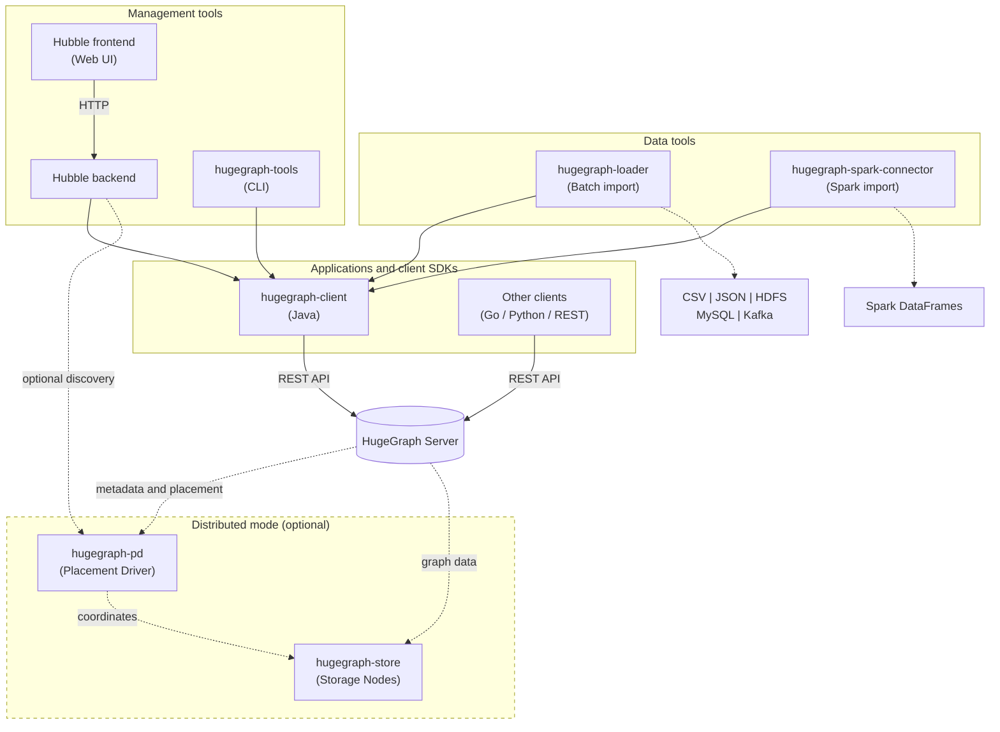

# Apache HugeGraph Toolchain

[](https://www.apache.org/licenses/LICENSE-2.0.html)
[](https://github.com/apache/hugegraph-toolchain/actions/workflows/client-ci.yml)
[](https://github.com/apache/hugegraph-toolchain/actions/workflows/loader-ci.yml)
[](https://github.com/apache/hugegraph-toolchain/actions/workflows/hubble-ci.yml)
[](https://github.com/apache/hugegraph-toolchain/actions/workflows/tools-ci.yml)
[](https://mvnrepository.com/artifact/org.apache.hugegraph/hugegraph-toolchain)

## What is HugeGraph Toolchain?

A comprehensive suite of client SDKs, data tools, and management utilities for [Apache HugeGraph](https://github.com/apache/hugegraph) graph database. Build applications, load data, and manage graphs with production-ready tools.

Hubble brings graph exploration, schema preparation, analysis, and cluster operations into one workspace. See [Server compatibility](hugegraph-hubble/README.md#authentication-connections-and-compatibility) for supported versions and features.

The cluster overview keeps service topology, node health, source status, and capacity facts in one operational view.

**Quick Navigation**: [Architecture](#architecture-overview) | [Quick Start](#quick-start) | [Modules](#module-overview) | [Build](#build--development) | [Docker](#docker) | [Documentation index](docs/README.md) | [Related Projects](#related-projects)

## Related Projects

**HugeGraph Ecosystem**:
1. [hugegraph](https://github.com/apache/hugegraph) - Core graph database (**[pd](https://github.com/apache/hugegraph/tree/master/hugegraph-pd)** / **[store](https://github.com/apache/hugegraph/tree/master/hugegraph-store)** / **[server](https://github.com/apache/hugegraph/tree/master/hugegraph-server)** / **[commons](https://github.com/apache/hugegraph/tree/master/hugegraph-commons)**)
2. [hugegraph-computer](https://github.com/apache/hugegraph-computer) - Distributed graph computing system
3. [hugegraph-ai](https://github.com/apache/hugegraph-ai) - Graph AI/LLM/Knowledge Graph integration
4. [hugegraph-doc](https://github.com/apache/hugegraph-doc) - Documentation and website

## Architecture Overview



The Java client is shared by Loader, the Hubble backend, Tools and the Spark
connector. Hubble's frontend communicates with its backend. In distributed mode,
Server obtains placement information from PD and sends data requests directly to
Store nodes.

<details>
<summary>ASCII diagram (for terminals/editors)</summary>

```text
Hubble frontend --HTTP--> Hubble backend --+
Loader / Tools / Spark -------------------+--> Java Client --REST--> Server
Go / Python / other clients ------------------------------REST--> Server
                                                            |  |
                                        metadata/placement -> PD
                                        graph data ---------> Store
```
</details>

## Quick Start

### Prerequisites

| Requirement | Version | Notes |
|-------------|---------|-------|
| JDK | 17+ | Build and run the core tools with Java 17 |
| Maven | 3.6.3+ | For building from source |
| HugeGraph Server | Official 1.7.0 | Released binary; see the migration guide for Server 1.5 scope |
| HugeGraph Server candidate | Source-built 1.8.0 | [Locked candidate](docs/java17-migration.md#build-the-locked-candidate), not an ASF release |

For the Java 17 candidate SDK, upgrade procedure and compatibility boundary, see [the migration guide](docs/java17-migration.md).

### Choose Your Path

| I want to... | Use this | Get started |
|--------------|----------|-------------|
| Visualize graphs in a browser | Hubble | [Hubble quick start](#hubble-docker-quick-start) |
| Load CSV/JSON data into a graph | Loader | [Loader guide](hugegraph-loader/README.md#2-quick-start) |
| Build a Java app with HugeGraph | Client | [Java example](#hugegraph-client) |
| Back up or restore graphs | Tools | [Tools guide](hugegraph-tools/README.md) |
| Write graph data from Spark | Spark Connector | [Spark Connector](#hugegraph-spark-connector) |

### Hubble Docker Quick Start

This example builds Hubble from the current checkout and connects it to a
standalone Server on a private Docker network. It is for local evaluation: the
Server is unauthenticated, its port is not published to the host, and Hubble's
HTTP port is bound to host loopback. Configure authentication and network
restrictions before exposing either service. Pin compatible released versions for
repeatable deployments.

Run from the repository root with a local Docker context. The bind mount and loopback port belong to the Docker daemon host:

```bash
# Create a private network and start Server on it
docker network create hugegraph-demo
docker run -d --name hugegraph-server --network hugegraph-demo hugegraph/hugegraph:1.7.0

# Build Hubble from this checkout
docker build -f hugegraph-hubble/Dockerfile -t hugegraph-hubble:local .

# Create a fresh config file for this source-built image
HUBBLE_CONFIG_DIR=$(mktemp -d)
sed -e 's|^server.host=.*|server.host=0.0.0.0|' \
    -e 's|^server.direct_url=.*|server.direct_url=http://hugegraph-server:8080|' \
    -e 's|^dashboard.address=.*|dashboard.address=|' \
    hugegraph-hubble/hubble-dist/assembly/static/conf/hugegraph-hubble.properties \
    > "$HUBBLE_CONFIG_DIR/hugegraph-hubble.properties"

docker run -d --name hubble --network hugegraph-demo \
  -p 127.0.0.1:8088:8088 \
  -v "$HUBBLE_CONFIG_DIR/hugegraph-hubble.properties:/hubble/conf/hugegraph-hubble.properties:ro" \
  hugegraph-hubble:local
```

Use Docker Engine 28.0.0 or later for the loopback publish. With an older Engine, configure and verify host or network isolation before running this unauthenticated local example because hosts on the same layer-2 network may still reach localhost-published ports. On an SELinux-enforcing host, change the private generated configuration mount suffix from `:ro` to `:ro,Z`; `Z` relabels that host file for exclusive container use.

This example assumes a local Docker context. With a remote daemon, create the bind-mounted configuration on the daemon host; `127.0.0.1` also refers to that remote host, so access it through an authenticated tunnel or another controlled channel. Do not expose a remote Docker API without TLS.

Open `http://127.0.0.1:8088` after startup; use `docker logs hubble` to diagnose
startup failures. This disposable example does not persist Hubble data. To connect
to a Server running on the host instead, Docker Desktop supplies
`host.docker.internal`; Linux Docker Engine may need
`--add-host host.docker.internal:host-gateway` on `docker run`. The Server must
listen on an address reachable from the container: a host-loopback-only port may
not be reachable from a bridged container. Protect externally reachable services.
For released images, compatibility, persistent storage and additional deployment
options, see the [Hubble guide](hugegraph-hubble/README.md#3-user-docker-image-convenient-for-testdev).

### Loader Quick Start

[Download or build the Toolchain distribution](hugegraph-loader/README.md#2-quick-start),
then change into its `apache-hugegraph-loader-<version>` directory, replacing
`<version>` with the distribution version. Run the launcher there so its sibling
`lib` and `conf` directories are available:

```bash
sh bin/hugegraph-loader.sh -f /path/to/mapping.json -g hugegraph
```

See the [Loader guide](https://hugegraph.apache.org/docs/quickstart/hugegraph-loader/)
for a complete mapping and input example.

## Module Overview

### hugegraph-client

**Purpose**: Official Java SDK for HugeGraph Server

**Key Features**:
- Schema management (PropertyKey, VertexLabel, EdgeLabel, IndexLabel)
- Graph operations (CRUD vertices/edges)
- Gremlin query execution
- Built-in traversers (shortest path, k-neighbor, k-out, paths, etc.)
- Multi-graph and authentication support

**Entry Point**: `org.apache.hugegraph.driver.HugeClient`

**Quick Example**:
```java
import org.apache.hugegraph.driver.HugeClient;
import org.apache.hugegraph.structure.constant.T;

try (HugeClient client = HugeClient.builder("http://localhost:8080", "hugegraph").build()) {
    client.schema().propertyKey("name").asText().ifNotExist().create();
    client.schema().vertexLabel("person").properties("name").primaryKeys("name")
          .ifNotExist().create();
    client.graph().addVertex(T.LABEL, "person", "name", "Alice");
}
```

📖 [Documentation](https://hugegraph.apache.org/docs/quickstart/hugegraph-client/) | 📁 [Source](./hugegraph-client)

---

### Other Client SDKs

<details>
<summary><b>hugegraph-client-go</b> (Go SDK - WIP)</summary>

**Purpose**: Official Go SDK for HugeGraph Server

**Key Features**:
- RESTful API client for HugeGraph
- Schema and graph operations
- Gremlin query support
- Idiomatic Go interface

**Entry Point**: `github.com/apache/hugegraph-toolchain/hugegraph-client-go`

**Quick Start**:
```bash
go get github.com/apache/hugegraph-toolchain/hugegraph-client-go
```

See the [module README](hugegraph-client-go/README.md) for client initialization
and response handling.

📁 [Source](./hugegraph-client-go)

</details>

> **Looking for other languages?** See [hugegraph-python-client](https://github.com/apache/hugegraph-ai/tree/main/hugegraph-python-client) in the hugegraph-ai repository.

---

### hugegraph-loader

**Purpose**: Batch data import tool from multiple data sources

**Key Features**:
- **Sources**: CSV, JSON, HDFS, MySQL, Kafka, existing HugeGraph
- JSON-based mapping configuration
- Parallel loading with configurable threads
- Error handling and retry mechanisms
- Progress tracking and logging

**Entry Point**: `bin/hugegraph-loader.sh`

**Quick Example**:

Run the launcher from the extracted Loader distribution as shown in the
[Loader Quick Start](#loader-quick-start). A complete file-source mapping and
input example is included under [`assembly/static/example/file`](hugegraph-loader/assembly/static/example/file/).

📖 [Documentation](https://hugegraph.apache.org/docs/quickstart/hugegraph-loader/) | 📁 [Source](./hugegraph-loader)

---

### hugegraph-hubble

**Purpose**: Web-based graph management and visualization platform

**Key Features**:
- GraphSpace and graph navigation within the configured deployment
- Interactive schema management with graphical editor
- Comprehensive data loading dashboard
- Dynamic graph visualization with path and topology canvas
- Built-in Gremlin query console & algorithm explorer
- Fine-grained user authentication & multi-language localization (i18n)

**Technology Stack**: Spring Boot + React + TypeScript + MobX + Ant Design

**Entry Point**: `bin/start-hubble.sh` (default port: 8088)

**Quick Start**: use the [Docker example](#hubble-docker-quick-start) above,
or follow the [Hubble deployment guide](hugegraph-hubble/README.md#quick-start) for
binary and source-based startup.

📖 [Documentation](https://hugegraph.apache.org/docs/quickstart/hugegraph-hubble/) | 📁 [Source](./hugegraph-hubble)

---

### hugegraph-tools

**Purpose**: Command-line utilities for graph operations

**Key Features**:
- Backup and restore graphs
- Graph migration
- Graph cloning
- Metadata management
- Batch operations

**Entry Point**: `bin/hugegraph` CLI commands

**Quick Start**: see the [Tools guide](https://hugegraph.apache.org/docs/quickstart/hugegraph-tools/)
for backup, restore and migration commands and their required connection options.

📁 [Source](./hugegraph-tools)

---

### hugegraph-spark-connector

**Purpose**: Write Spark DataFrames to HugeGraph

**Key Features**:
- Write vertex and edge DataFrames to HugeGraph
- Spark DataSource integration
- Distributed graph processing

**Entry Point**: Scala API with Spark DataSource v2

**Quick Example**:

The [Spark Connector README](hugegraph-spark-connector/README.md#how-to-use)
contains complete vertex and edge DataFrame examples, including the schema and
connection options required by the connector.

📁 [Source](./hugegraph-spark-connector)

## Maven Dependencies

The Java client is published as `org.apache.hugegraph:hugegraph-client`. Select a
released version compatible with your Server from [Maven Central](https://mvnrepository.com/artifact/org.apache.hugegraph/hugegraph-client)
and set that version in your application's POM. See the [Client module](hugegraph-client/)
for API and compatibility details.

## Build & Development

For build prerequisites, SDK selection, and release instructions, see the
[Java 17 migration guide](docs/java17-migration.md). The commands below cover
local builds and tests for contributors.

<details>
<summary>Build and test commands</summary>

### Full Build

Normal builds use the 1.8.0 SDK and release packaging checks. Select the staging repository in Maven settings and use an isolated local repository:

```bash
release_settings=/absolute/path/to/settings-with-selected-staging.xml
release_repository=$(mktemp -d /tmp/hugegraph-release-m2.XXXXXX)
mvn --settings "$release_settings" -Dmaven.repo.local="$release_repository" clean install \
  -DskipTests -Dmaven.javadoc.skip=true -ntp
```

Distribution packaging requires Python 3.9 or newer. Release mode checks required SDK POM/JARs and packaged library versions and bytes, and rejects
candidate manifests. Add `-Papache-release` for the Apache release profile; see [release packaging](docs/java17-migration.md#release-packaging).
To build the pinned same-source 1.8.0 SDK instead, follow [the bootstrap instructions](docs/java17-migration.md#build-the-locked-candidate) and supply
`-Dmaven.repo.local="$candidate_dir/m2" -Dhugegraph.version=1.8.0 -Dsdk.validation.mode=candidate` to every module build.

The aggregate Maven module is `org.apache.hugegraph:hugegraph-toolchain-dist:1.8.0`, distinct from Server's `hugegraph-dist` coordinate.
Its source directory remains `hugegraph-dist`; the release archive remains `apache-hugegraph-toolchain-1.8.0.tar.gz`.

### Module-Specific Builds

Until the 1.8.0 SDK is available in Maven Central, apply the same `--settings "$release_settings"` and
`-Dmaven.repo.local="$release_repository"` options from Full Build to each Maven command below.

| Module | Build Command |
|--------|---------------|
| Client | `mvn -e compile -pl hugegraph-client -Dmaven.javadoc.skip=true -ntp` |
| Loader | `mvn install -pl hugegraph-client,hugegraph-loader -am -DskipTests -ntp` |
| Hubble | `mvn install -pl hugegraph-hubble/hubble-dist -am -DskipTests -ntp` |
| Tools | `mvn install -pl hugegraph-client,hugegraph-tools -am -DskipTests -ntp` |
| Spark | `mvn install -pl hugegraph-client,hugegraph-spark-connector -am -DskipTests -ntp` |
| Go Client | `cd hugegraph-client-go && make all` |

Hubble frontend builds require stable Node.js 24 (at least the version in
[`hubble-fe/.node-version`](hugegraph-hubble/hubble-fe/.node-version)) and the exact pnpm version
in [`hubble-fe/package.json`](hugegraph-hubble/hubble-fe/package.json). Install Corepack if your
Node distribution does not include it, then run `corepack enable` and `pnpm --version` from
`hugegraph-hubble/hubble-fe` before the Maven build. Later Node 24 patch/minor releases are supported;
Node 25 and prerelease builds require a separate compatibility upgrade.

### Running Tests

For Maven tests, use the same SDK repository settings as for the module builds.
Some suites require a running Server or other external services.

After a Client change, run the Loader install command above with the same `--settings` and `-Dmaven.repo.local` options before any Loader tests. After a Loader change, install Loader with those same Maven repository settings before Hubble backend tests. This keeps both suites on the current Client and Loader artifacts instead of stale local copies.

| Module | Test Type | Command |
|--------|-----------|---------|
| Client | Unit (no server) | `mvn test -pl hugegraph-client -Dtest=UnitTestSuite` |
| Client | API (server needed) | `mvn test -pl hugegraph-client -Dtest=ApiTestSuite` |
| Client | Functional | `mvn test -pl hugegraph-client -Dtest=FuncTestSuite` |
| Loader | Unit | `mvn test -pl hugegraph-loader -P unit` |
| Loader | File sources | `mvn test -pl hugegraph-loader -P file` |
| Loader | HDFS | `mvn test -pl hugegraph-loader -P hdfs` |
| Loader | JDBC | `mvn test -pl hugegraph-loader -P jdbc` |
| Loader | Kafka | `mvn test -pl hugegraph-loader -P kafka` |
| Hubble | Unit | `mvn test -P unit-test -pl hugegraph-hubble/hubble-be` |
| Tools | Functional | `mvn test -pl hugegraph-tools -Dtest=FuncTestSuite` |

### Code Style

Checkstyle is enforced via `tools/checkstyle.xml`:
- Max line length: 120 characters
- 4-space indentation (no tabs)
- No star imports
- No `System.out.println`

Run checkstyle:
```bash
mvn checkstyle:check
```

</details>

## Docker

The [Hubble Docker quick start](#hubble-docker-quick-start) shows how to build
and configure a Hubble container from this checkout. For published Hubble and
Loader image usage, consult the corresponding [Hubble](hugegraph-hubble/README.md#quick-start)
and [Loader](hugegraph-loader/README.md#2-quick-start) module guides.

Build images from the Toolchain repository root so the context contains the shared SDK bootstrap and verifier:
```bash
# Loader
docker build -f hugegraph-loader/Dockerfile \
  -t hugegraph/hugegraph-loader:latest .

# Hubble
docker build -f hugegraph-hubble/Dockerfile \
  -t hugegraph/hugegraph-hubble:latest .
```

<details>
<summary>Multi-platform build details</summary>

Multi-platform builds use BuildKit's automatic platform arguments. The Maven
and Node build stages run on `$BUILDPLATFORM`, while the final JRE stage uses
`$TARGETPLATFORM`. Java bytecode and frontend assets are architecture-neutral,
so they are built once without QEMU. Target-stage package installation still
runs for each architecture.

This optimization applies only to architecture-independent build outputs. A
component that compiles native code must use a target-platform build stage or
separate platform stages. Loader and Hubble packaging is validated on arm64;
native dependencies must still be audited. Loader includes arm64 variants for
Snappy, LZ4, Commons Crypto, and gRPC tcnative. Some optional legacy HBase and
Jansi natives remain x86-only, so their fallback paths require target-runtime
validation when those optional features are used.

</details>

## Documentation

- [HugeGraph Toolchain Overview](https://hugegraph.apache.org/docs/quickstart/)
- [hugegraph-client Guide](https://hugegraph.apache.org/docs/quickstart/hugegraph-client/)
- [hugegraph-loader Guide](https://hugegraph.apache.org/docs/quickstart/hugegraph-loader/)
- [hugegraph-hubble Guide](https://hugegraph.apache.org/docs/quickstart/hugegraph-hubble/)
- [API Reference](https://hugegraph.apache.org/docs/)
- [CI behavior](docs/ci.md)

## Contributing

Welcome to contribute to HugeGraph! Please see [How to Contribute](https://hugegraph.apache.org/docs/contribution-guidelines/contribute/) for more information.

Before committing a new source or test file, run the same license-header check
used by CI (`license-eye` from `apache/skywalking-eyes` is required):

```bash
./tools/check-license-header.sh
```

Do not use shortened Apache headers: the complete header configured in
`.licenserc.yaml` is required.

**Note**: It's recommended to use [GitHub Desktop](https://desktop.github.com/) to simplify the PR and commit process.

Thank you to all the people who already contributed to HugeGraph!

[](https://github.com/apache/hugegraph-toolchain/graphs/contributors)

## Community & Contact

- [GitHub Issues](https://github.com/apache/hugegraph-toolchain/issues) - Report bugs and request features
- Email: [dev@hugegraph.apache.org](mailto:dev@hugegraph.apache.org) ([subscriber](https://hugegraph.apache.org/docs/contribution-guidelines/subscribe/) only)
- Slack: [ASF Channel](https://the-asf.slack.com/archives/C059UU2FJ23)
- WeChat: Apache HugeGraph (scan QR code below)


## License

hugegraph-toolchain is licensed under [Apache 2.0 License](https://github.com/apache/hugegraph-toolchain/blob/master/LICENSE).