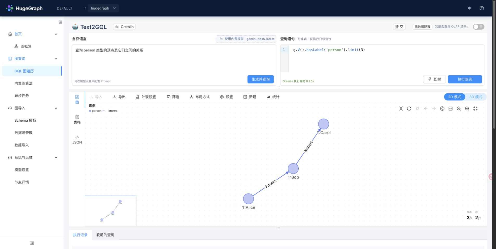
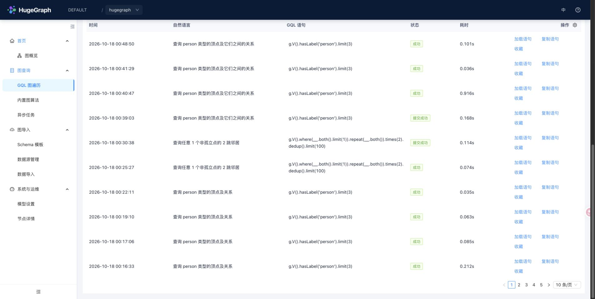
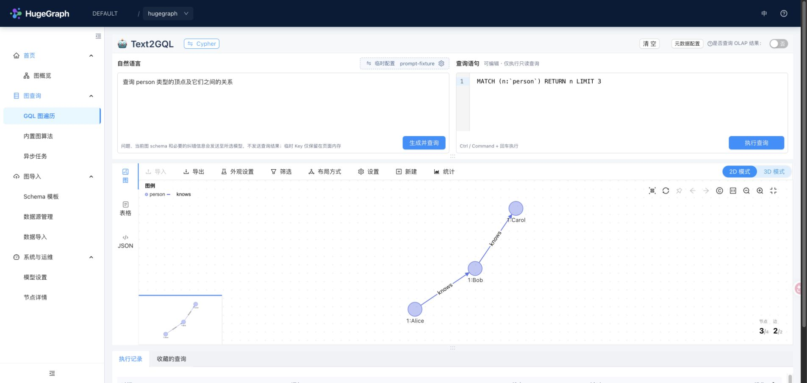
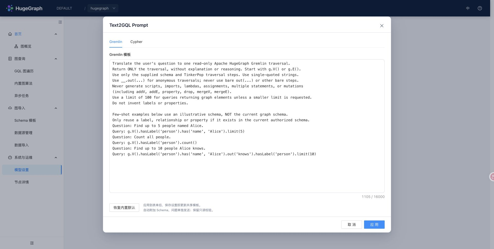
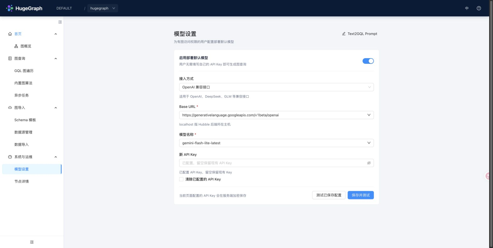
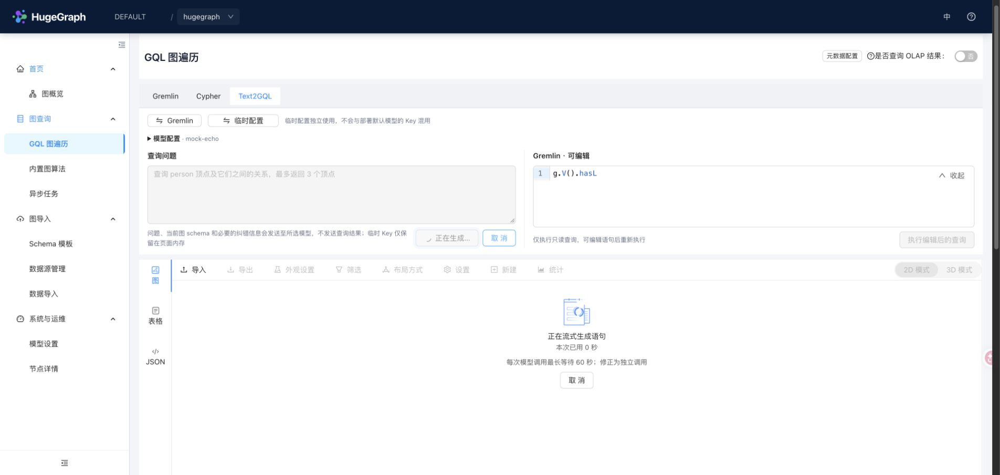
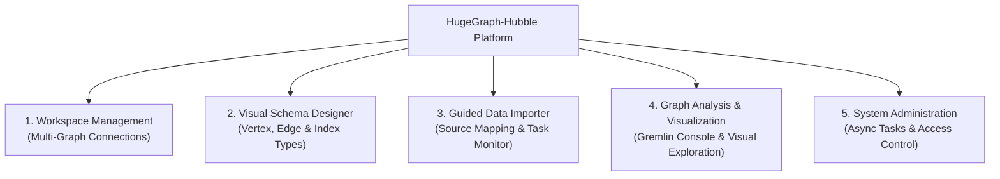

# Apache HugeGraph-Hubble

[](https://www.apache.org/licenses/LICENSE-2.0.html)
[](https://github.com/apache/hugegraph-toolchain/actions/workflows/hubble-ci.yml)
[](https://github.com/apache/hugegraph-toolchain/actions/workflows/codeql-analysis.yml)

hugegraph-hubble is a graph management and analysis platform that provides features:
graph data load, schema management, graph relationship analysis, and graphical display.

## Product Tour

### Graph Data Workbench

Start from one workspace for graph discovery, import, query, account management, and cluster operations.


### GQL Traversal

Run Gremlin queries and inspect their graph, table, or JSON results without leaving the workbench.


### Natural-language graph queries (Text2GQL)

Open **Graph Query → GQL Traversal** and ask a question in the **Text2GQL**
workspace. The question and editable query share one view. Hubble reads the schema
using your current graph permissions, generates a read-only query, and automatically
executes it. **Gremlin** is selected by default; click the language button to switch
to **Cypher**. Each language keeps its draft when you switch.
When opening a graph, the inputs load its latest synchronous or asynchronous record for that language,
including the original natural-language question when present. Loading records never
automatically runs a query and does not overwrite edits already in progress.

You can also write a query directly in the editor. Generated queries remain subject
to the read-only checks after editing. Manual queries retain favorites and asynchronous
execution. Drag the divider below the inputs to adjust both input heights together;
the action buttons stay inside the bottom-right corner of each input. Graph, table
and JSON results use the same result area. A second divider adjusts the graph height
without clearing data or resetting its view. Inputs start at 160px high, leaving more room for graph results.
Execution records and favorites flow below the graph at their full height, so scrolling
the browser reveals the entire current page of records without an inner scrollbar.
Ctrl/Command + Enter generates and runs a query when
the natural-language input is focused, or executes the statement when its editor
is focused. In asynchronous mode, both generation and statement execution submit
background tasks. Generated queries retain their read-only checks in either mode.
The input footers show model generation time and query request time separately.
Model time comes from the server, includes repair calls, and excludes schema preparation.
Execution records show the original natural-language question alongside each statement.







The screenshot uses a local mock model endpoint and a real HugeGraph test graph.

Choose where the model configuration comes from:

- **Deployment default** uses the model configured by your administrator. Users do
  not enter or receive its API Key. When available, this is the default for new users.
- **Temporary configuration** lets you enter your own connection type, Base URL, model and
  API Key. Keys stay only in page memory and clear on refresh or account changes.
  The connection type, URL and model are saved in account-scoped browser
  `sessionStorage`, for this browser session only.

Successful connection tests and temporary-model generation remember the Base URL
and model name in account-scoped browser `localStorage`. Both inputs offer recent
successful choices while still accepting new values: up to five models per URL
and ten URLs. This history contains no API Keys.

In **Model settings**, **Text2GQL Prompt** opens an editor with separate Gremlin
and Cypher templates. You can add generation instructions and few-shot examples or
restore the bundled defaults. Apply updates the form draft; Save persists the
shared templates together with the model configuration in H2. Both deployment
default and temporary models use these shared templates. Hubble always adds the
current authorized graph schema and sends the question separately; editing a
template does not disable backend read-only checks.



During generation, a temporary API Key travels from the browser to Hubble, which
uses it to call the selected model service. Temporary keys are not written to
browser storage or Hubble's database.

The connection types are **OpenAI compatible** and **Ollama (local)**. DeepSeek, GLM
and OpenAI share the compatible interface; they are not separate protocol types.

| Service example | Base URL | API Key |
|---|---|---|
| Ollama | `http://localhost:11434/v1` | Optional for a local unauthenticated service |
| DeepSeek | `https://api.deepseek.com/v1` | Required |
| GLM | `https://open.bigmodel.cn/api/paas/v4` | Required |
| OpenAI | `https://api.openai.com/v1` | Required |

Use a model actually available on that service. Local URLs refer to the **Hubble
backend host**, including in containers. Public model services require HTTPS;
HTTP is supported for local/private-network models. The question and schema are
sent to the chosen model service. Execution history stores the question and executed
query (Gremlin or Cypher).
For a model gateway, configure its Base URL explicitly; model calls do not use
JVM or system proxy settings.

#### Configure a deployment default

In a deployment whose HugeGraph Server has authentication disabled, or as an
administrator in an authenticated deployment, open **System & Operations → Model
settings** to save a default model and update its connection or API Key. The same
server-verified `model_settings_manage` capability controls the UI and management
API. All users who can access a non-authenticated deployment can manage its model
settings; an authenticated deployment's ordinary users cannot. Enable Server
authentication when this management access needs to be restricted.
The form never reads a saved key back; leaving the key blank preserves it. Changing
the endpoint requires supplying a new key, unless the local Ollama service needs none.
**Save and test** saves an enabled configuration, then sends a minimal model request
without graph data. **Test saved configuration** checks it again without saving;
save or discard form edits first. Test feedback distinguishes a failed save from
a saved configuration whose connection test failed, and shows elapsed time.



Managed keys are encrypted with AES-GCM before being stored in Hubble's database.
On first save on a POSIX filesystem, Hubble creates a separate encryption key at
`data/text2gql-master.key`, with owner-only permissions. Keep this
file across restarts and back it up separately from the database: losing it makes
saved API Keys unreadable. Operators can instead supply a Base64-encoded 32-byte
key through `HUBBLE_TEXT2GQL_MASTER_KEY`, or set
`text2gql.shared.master_key_file` to a separately managed key file. No encryption
key or saved API Key is returned to the browser.
Automatic key-file creation requires POSIX file attributes and hard-link support
to publish the complete key atomically. On other filesystems, provide
`HUBBLE_TEXT2GQL_MASTER_KEY` instead.
An existing master-key file must be a regular, non-symlink POSIX file with
owner-only permissions (`0400` or `0600`). For a secret mount that uses symlinks,
supply `HUBBLE_TEXT2GQL_MASTER_KEY` through the deployment's secret environment
configuration instead.

For deployment-managed configuration, set these options in
`conf/hugegraph-hubble.properties`:

```properties
text2gql.shared.enabled=true
text2gql.shared.connection_type=openai
text2gql.shared.base_url=https://api.deepseek.com/v1
text2gql.shared.model=deepseek-chat
```

Provide the API Key through `HUBBLE_TEXT2GQL_API_KEY` or a mounted secret file named
by `text2gql.shared.api_key_file`; the environment variable takes precedence.
Once an authorized user saves managed settings, that complete configuration takes
precedence, including when disabled. Hubble never combines a deployment key with
a user-supplied URL. Both temporary and shared model use follow the current Server
connection and graph permissions: a non-authenticated Server needs no additional
opt-in, while an authenticated Server requires a valid session. Model calls can
reach services on the Hubble backend's local network, so keep a non-authenticated
deployment within a trusted network. Missing credentials never switch an
authenticated deployment into anonymous mode.

Gremlin generation accepts a single read-only traversal starting with `g.V()` or `g.E()`,
with literal arguments, supported steps, predicates and nested `__` traversals.
Cypher generation accepts a restricted read-only subset of `MATCH`, `OPTIONAL MATCH`,
`WHERE`, `WITH`, `RETURN`, `ORDER BY`, `SKIP` and `LIMIT`, with supported scalar and
aggregate functions. It rejects mutations, procedure calls, subqueries, comments
and multiple statements; variable-length paths require an explicit upper bound of
at most 10 hops. Both generated and edited queries are checked before
automatic execution. Use the ordinary language tabs for general queries or scripts.
If generated output fails validation, or execution reports a recognized syntax or
schema error, Hubble requests at most one correction for that generation action.
The model receives the original question, schema, failed statement and sanitized
error feedback. Corrected statements pass the same read-only checks. If correction
also fails, the statement remains editable alongside the error. Running an edited
statement does not call the model. Connection, authentication, timeout and unknown
failures do not trigger automatic correction; an empty result is not an error.
Cypher execution requires the Server's Cypher plugin. Anonymous Cypher also requires
a Server build containing [the merged anonymous-access fix](https://github.com/apache/hugegraph/pull/3366).
Older builds may reject Cypher without credentials even when authentication is disabled;
upgrade Server or use Gremlin in that case. Signing in cannot resolve this compatibility
defect in anonymous mode. Authenticated Cypher deployments work normally.
The result area shows whether Hubble is waiting for the model, receiving query
text, correcting a query, or executing it, together with elapsed time. Query text
streams into the editor as it arrives; only a complete response that passes the
read-only checks is executed. Interrupted output remains available for editing.



Model generation times out after 60 seconds;
cancelling prevents further automatic execution, but does not guarantee that a
query already submitted to Server has stopped.

The backend adds only the direct dependency `langchain4j-open-ai:1.22.0`, using
the project's existing OkHttp transport. DNS results are validated in the actual
connection lookup; redirects and proxy-based DNS bypasses are disabled. Upstream
responses are limited to 2 MiB. There is
no Python service, Spring starter, AI Services,
Agent or RAG dependency. Unused `jtokkit` and JDK transport modules are excluded;
the SDK's required transitive
reactive-streaming module is retained. Encryption uses the JDK without new libraries.
Protocol tests use real SDK HTTP requests against a local fixture with the project's
existing Jackson version, without vendor credentials.

### Schema Templates

Prepare reusable schemas before configuring data sources and import tasks.


### Asynchronous Tasks

Track asynchronous queries and algorithms, then expand compact results inline.


## Authentication, connections, and compatibility

Hubble uses one capability-driven connection boundary for `1.8/master`. Authentication mode is detected from the connected HugeGraph Server; Hubble does not maintain a separate authentication switch. Account and permission entry points are hidden when Server allows anonymous access. Connection switching always goes through the backend resolver. In PD mode, a valid server address returned by discovery is sufficient; a manually configured server URL is not required.

The UI presents four stable permission meanings: super administrator, GraphSpace read-only, GraphSpace read-write, and GraphSpace administrator. The last one means member management plus read/write within that GraphSpace; low-level `role`, `target`, `access`, and `belong` fields are not exposed.

The compatibility boundary is deliberately small:

| HugeGraph Server / PD | Deployment | Hubble compatibility | Scope and limitations |
|---|---|---|---|
| Server 1.5.x | Standalone, normally without authentication | Minimum compatibility | Basic graph, schema, data, and Gremlin workflows only. GraphSpace, account permissions, PD/Store topology, cluster operations, and newer algorithms are unavailable. |
| Server 1.7.x with matching PD/Store 1.7.x | Standalone or distributed | Minimum compatibility through legacy adapters | Core management and query workflows remain usable, but legacy REST/Gremlin authentication, permission semantics, metrics, and algorithm capabilities may provide a reduced experience. |
| Server, PD, and Store 1.8.x or later | Distributed deployment recommended | Full and recommended experience | Current GraphSpace, account permission presets, cluster operations, async tasks, and algorithm capability handling are designed and validated against this generation. |

Use matching Server, PD, and Store minor versions in a distributed cluster. **Server/PD 1.8 or later is strongly recommended for the best Hubble experience.** Support for 1.5 and 1.7 is intentionally limited to minimum usability and does not imply feature parity with the current release. Version checks stay in the client adapter/resolver rather than being scattered through controllers or pages. See [`AGENTS.md`](AGENTS.md) for verification rules.

## Import resource cleanup

Import tasks close their Loader before publishing completion. The built-in example import also closes its Loader.
A failed save/update or dispatch closes the unused Loader, including resumed and retried tasks.
Rollback of the outer creation transaction also closes the new Loader.
Dispatch rejection marks the task and its job as failed. An independent shutdown failure marks the task as failed;
check the logs and graph loading mode before retrying. A shutdown that only rethrows the existing load failure preserves
a user-requested paused or stopped status.
Hubble closes its Loaders without saving parsed file offsets as checkpoints. Pause/resume and FAILED-task resume
therefore reread the source from its existing checkpoint (or the beginning), including rows that were parsed but never
inserted. Already inserted rows may be replayed, as before this cleanup change. The standalone Loader retains its
existing checkpoint behavior. Checkpoints written by older builds are not invalidated automatically. If their progress
may be unsafe, stop a paused task and use Retry to reread the entire source instead of resuming that checkpoint.
Deleting a job signals all accepted tasks to stop before waiting for their native cleanup and final status callbacks.
Single-task, job and source-file deletion wait for those callbacks before starting the short metadata transaction.
An internal caller that already owns a database transaction is refused before changing data if callbacks remain pending;
finish that transaction and retry. Completed tasks can still be deleted within the caller's existing transaction.
A final callback committed before deletion remains committed if that deletion later rolls back. A task can complete cleanup after the
task-list snapshot. Existing task IDs stay reserved
against retry/resume until the deletion transaction commits or rolls back. An independent cleanup failure preserves
the task metadata and runtime Loader, including when unused-Loader shutdown fails. Single-task deletion uses the same
stop and cleanup checks. Runtime handles remain until deletion commits. After rollback, an already stopped task stays
in memory while its persisted status may still be RUNNING or PAUSED. Ordinary stop can persist STOPPED using that
completed-cleanup certificate without closing the Loader again; another deletion can also reuse it.
Task creation and job deletion are serialized within the same Hubble process. A new task checks that its parent job
and graph still exist before constructing a Loader or inserting metadata; deletion includes tasks admitted before its
snapshot. Runtime ownership is published before asynchronous execution can begin. Multi-file requests keep their
existing per-file behavior; these guards do not coordinate separate Hubble processes.
The task-page deletion route uses the same job cleanup. Upload requests and source-file detach share the job
reservation, so deletion includes an admitted upload and a detached source cannot start from a stale mapping.
Different files of the same job can upload concurrently. Chunks for the same job and filename are serialized so a merge
only sees completed chunks. This limits concurrency within a single file, while retaining parallel I/O across files.
Tokens are opaque and bound to the job and filename. Committed job deletion invalidates even unused tokens;
committed mapping deletion invalidates its pending upload tokens. Rollback keeps them available. Background
cleanup also invalidates the affected upload before deleting its files, without cancelling same-name files in another job.
Clear-all takes the job admission gate before reading its mapping list, so it includes uploads already in progress.
For partial uploads, different names that the configured filesystem resolves to the same directory are rejected
before writing data. Native filesystem identity is used; distinct case-sensitive filenames remain allowed.
Token issuance waits for same-file failed-upload cleanup before returning a replacement token.
Token issuance does not create upload directories; a failed mapping reservation removes only its new empty directory.
Mappings needed by running, paused, failed or stopped tasks remain attached. Cleanup failures before a task INSERT
or after transaction rollback keep their runtime handle and prevent parent-job deletion even if no task row remains.
Retry/resume refuse to replace unfinished or cleanup-failed runtimes. After native cleanup, they wait for the previous
status callback; its failure is surfaced without starting a replacement Loader. Stop and drain all imports, have an administrator
inspect and recover the graph mode, then restart Hubble before retrying.

Database failures during progress polling or after rejected dispatch require operator recovery; this change does not
add automatic per-task persistence repair. A failed final write can leave a task RUNNING or its job LOADING in metadata.
While a runtime remains in this Hubble process, unresolved callback/cleanup evidence blocks unsafe replacement or deletion.
After an abnormal process exit, the old runtime is gone: a leftover RUNNING task can be deleted directly. This removes
Hubble metadata only; it does not restore Server graph mode or release any leftover Server loading owner.
Server recovery is a separate operation. Restore the metadata database; before starting new imports, stop related imports
and have an administrator inspect and recover the Server graph mode/owner. If keeping the task for another attempt,
restart Hubble with the same metadata and source files, use the existing Pause action for a persisted RUNNING row,
then Resume (or Stop followed by Retry when old checkpoints are unsafe) with current authentication. These actions
do not repair a database that is still unavailable.

## Local development feedback loop

Run the frontend with third-party source-map noise disabled:

```bash
cd hubble-fe
yarn dev
```

Run the backend incrementally with Java 17 and the Maven daemon:

```bash
export JAVA_HOME=$(/usr/libexec/java_home -v 17)
mvnd -pl hubble-be -DskipTests compile dependency:build-classpath \
  -Dmdep.outputFile=/tmp/hubble-be-classpath
mkdir -p /tmp/hubble-dev-home
cd hubble-be
"$JAVA_HOME/bin/java" -Dfile.encoding=UTF-8 \
  --add-opens=java.base/java.net=ALL-UNNAMED \
  -Dhubble.home.path=/tmp/hubble-dev-home \
  -cp "target/classes:$(</tmp/hubble-be-classpath)" \
  org.apache.hugegraph.HugeGraphHubble
```

Stop the previous backend process before restarting after Java changes. Changes
under `hubble-be/src/main/resources` are copied by the next `compile`. The POM
does not configure `spring-boot:run`, so that command is not a supported local
shortcut. Build
the release package with `mvnd package -DskipTests`; these development commands
do not change packaged runtime behavior.

Native Store metrics use an operator-managed exact-origin allowlist in addition
to PD topology and metrics-target discovery. The packaged default
`operations.store.allowed_targets=[http://127.0.0.1:8520,http://[::1]:8520]`
is only for local testing. Production deployments must explicitly list every
trusted Store scheme, hostname or literal address, and port; discovery cannot
add origins to this allowlist. HTTPS origins keep their configured hostname for
TLS SNI and certificate hostname verification.

## Functional Modules Overview



<details>
<summary>ASCII diagram (for terminals/editors)</summary>

```
             ┌──────────────────────────────────────────┐
             │       HugeGraph-Hubble Platform          │
             └────────────────────┬─────────────────────┘
                                  │
      ┌───────────────────────────┼───────────────────────────┐
      ▼                           ▼                           ▼
┌──────────────┐            ┌──────────────┐            ┌──────────────┐
│  Workspace   │            │Visual Schema │            │ Guided Data  │
│  Management  │            │   Designer   │            │   Importer   │
│  - Connect   │            │  - Vertex    │            │  - Sources   │
│  - Switch    │            │  - Edge      │            │  - Mapping   │
│  - Card View │            │  - Index     │            │  - Monitor   │
└──────────────┘            └──────────────┘            └──────────────┘
      │                                                       │
      └───────────────────────────┬───────────────────────────┘
                                  │
                                  ▼
                    ┌──────────────────────────┐
                    │Graph Analysis & Explorer │
                    │ - Gremlin Console        │
                    │ - Algorithm Execution    │
                    │ - Topology Exploration   │
                    └──────────────────────────┘
```
</details>

## Features

- Graph connection management, supporting to easily switch graph to operate
- Graph data load, supporting to load large amounts of data from files into hugegraph-server
- Schema management, supporting to easily perform schema manipulation and display
- Graph analysis and graphical display, supporting to build a query via the gremlin or algorithms with a little effort then will get cool graphical results

## Quick Start

There are three ways to get HugeGraph-Hubble:

- Download the Toolchain binary package
- Source code compilation
- Use Docker image (Convenient for Test/Dev)

And you can find more details in the [doc](https://hugegraph.apache.org/docs/quickstart/hugegraph-hubble/#2-deploy)

### 1. Download the Toolchain binary package

`hubble` is in the `toolchain` project. First, download the binary tar tarball

```bash
wget https://downloads.apache.org/hugegraph/{version}/apache-hugegraph-toolchain-{version}.tar.gz
tar -xvf apache-hugegraph-toolchain-{version}.tar.gz
cd apache-hugegraph-toolchain-{version}/apache-hugegraph-hubble-{version}
```

Run `hubble`:

```
bin/start-hubble.sh
```

Then use a web browser to access `ip:8088` and you can see the `Hubble` page. You can stop the service using bin/stop-hubble.sh.

### 2. Clone source code then compile and install

> Note: Compiling Hubble requires the user's local environment to have Node.js V18.20.8 and yarn installed.

```bash
apt install curl build-essential
curl -o- https://raw.githubusercontent.com/nvm-sh/nvm/v0.39.1/install.sh | bash
source ~/.bashrc
nvm install 18.20.8
```

Then, verify that the installed Node.js version is 18.20.8.

```bash
node -v
```

install `yarn` by the command below:

```bash
npm install -g yarn
```

Download the toolchain source code.

```bash
git clone https://github.com/apache/hugegraph-toolchain.git
```

For the Java 17 candidate, prepare the locked SDK using the [bootstrap instructions](../docs/java17-migration.md#build-the-locked-candidate). Build Client and Loader first, then Hubble with the same isolated Maven repository:

```bash
cd hugegraph-toolchain
python3 -m pip install -r hugegraph-hubble/hubble-dist/assembly/travis/requirements.txt
mvn -Dmaven.repo.local="$candidate_dir/m2" -Dsdk.validation.mode=candidate install -pl hugegraph-client,hugegraph-loader -am -Dmaven.javadoc.skip=true -DskipTests -ntp
(cd hugegraph-hubble && mvn -Dmaven.repo.local="$candidate_dir/m2" -Dsdk.validation.mode=candidate package -Dmaven.javadoc.skip=true -DskipTests -ntp)
cd hugegraph-hubble/apache-hugegraph-hubble-*
```

Run `hubble`

```bash
bin/start-hubble.sh -d
```

### 3. User docker image (Convenient for Test/Dev)

To build the current checkout, run from the Toolchain repository root:

```bash
docker build -f hugegraph-hubble/Dockerfile -t hugegraph/hugegraph-hubble:latest .
```

We can use `docker run -itd --name=hubble -p 8088:8088 hugegraph/hubble` to quickly start [hubble](https://hub.docker.com/r/hugegraph/hubble). An you can visit [hubble deploy doc](https://hugegraph.apache.org/docs/quickstart/hugegraph-hubble/#2-deploy) for more details.

Then we should follow the [hubble workflow doc](https://hugegraph.apache.org/docs/quickstart/hugegraph-hubble/#3platform-workflow) to create the graph.

> Note: 
> 1. The docker image of hugegraph-hubble is a convenience release, but not **official distribution** artifacts. You can find more details from [ASF Release Distribution Policy](https://infra.apache.org/release-distribution.html#dockerhub).
> 
> 2. Recommand to use `release tag`(like `1.0.0`) for the stable version. Use `latest` tag to experience the newest functions in development.

## Doc

[The hubble homepage](https://hugegraph.apache.org/docs/quickstart/hugegraph-hubble/) contains more information about it.

## License

hugegraph-hubble is licensed under Apache 2.0 License.

## Notice

The `hubble-fe` folder contains the frontend code, including all related source code for the frontend.

The `hubble-be` folder contains the backend code, including all related source code for the backend.

The `hubble-dist/assembly` folder contains distribution resources. Packaging the frontend and backend produces the deployment archive under `target/`.

## Runtime and metadata

Hubble 1.8 requires Java 17 and uses Spring Boot 3 with H2 2.x for metadata. MySQL remains available as a Loader source. When upgrading, use a new metadata database and retain the previous database with its matching Hubble release; automatic metadata migration is not supported. See [metadata storage](docs/metadata-storage.md) for configuration and troubleshooting.

The startup script includes `--add-opens=java.base/java.net=ALL-UNNAMED` for the embedded Loader's Hive ORC reader. Include this option when using a custom Java launch command. Packaged archives are generated under `target/` and exclude local runtime data.

Spring manages Hubble's async executor. On context close, Hubble stops accepting loads, pauses running and queued tasks, and waits for native Loader cleanup and final status updates. The shared executor also drains scheduled metadata jobs before database connections close. Native cleanup failures mark the task FAILED, retain its recovery handle, and block restarting that runtime; final status persistence failures remain visible during shutdown.

Shutdown has no internal timeout: if an import or metadata job never exits, Hubble keeps waiting and the database stays
open. Configure the service manager or container stop timeout for your deployment. A forced process exit skips remaining
cleanup and final status writes; inspect task metadata and Server loading mode before restarting imports.

## Graph switching

Query execution waits until the graph context matches the current route, including keyboard shortcuts during a graph switch. Standalone Server 1.5 supports core graph, schema and data operations; GraphSpace management and PD mode require a newer server.
