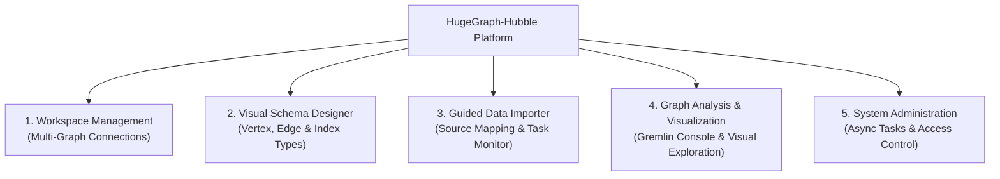

# Apache HugeGraph-Hubble

[](https://www.apache.org/licenses/LICENSE-2.0.html)
[](https://github.com/apache/hugegraph-toolchain/actions/workflows/hubble-ci.yml)
[](https://github.com/apache/hugegraph-toolchain/actions/workflows/codeql-analysis.yml)

hugegraph-hubble is a graph management and analysis platform that provides features:
graph data load, schema management, graph relationship analysis, and graphical display.

## Graph-space quotas and usage

The [GraphSpace interactions and fixture runner](docs/graphspace-interactions.md)
guide covers card navigation, editing, failure recovery, pagination and the
repeatable stateful API fixture.

New graph spaces start with 128 CPU cores, 128 GB memory, 128 compute CPU cores,
128 GB compute memory, 256 GB storage and 100 graphs. Server also defaults the
role limit to 100. Existing spaces retain their configured limits. Large finite
quotas display their actual values; only the legacy `Integer.MAX_VALUE` sentinel
is shown as unlimited, with `--` instead of a percentage because it has no finite
quota denominator. Its used storage remains visible.

For API creation requests, omitted compute limits use Server's persisted `0`
inheritance setting. Each zero continues following the corresponding graph-service
CPU or memory limit when that limit changes; positive compute limits stay fixed.
All-omitted requests therefore have effective compute limits of 128/128. On API
updates, omitted compute fields stay omitted through the Java client, so Server
preserves their existing setting atomically. Explicit zero restores inheritance.
Existing positive settings are not migrated.

Upgrade the Java Client with this paired Server change before using partial
GraphSpace updates. The client preserves omitted compute fields, explicit zero
and explicit positive values, including values read back from Server. Older
clients serialize an unset compute limit as zero; the new Server interprets
that explicit zero as restoring inheritance. If a client cannot be upgraded,
read the existing GraphSpace before updating it or explicitly send its current
compute limits to preserve them. Server cannot distinguish those legacy default
zeros from an intentional request to restore inheritance.

Cards and tables label zero compute limits as `Inherited (current effective limit)`.
The editor accepts zero, shows its effective limit, and preserves zero when only
graph-service CPU or memory changes. The creation form still starts all four
fields at an explicit 128 and submits the values shown in the form.
Clearing a compute field has the same inheritance meaning as zero and shows its
effective limit before saving. Restoring inheritance while editing requires the
paired [Server fix](https://github.com/apache/hugegraph/pull/3391); older Servers
can acknowledge zero while retaining the existing positive limit. The legacy
storage-usage fallback remains available with older Servers.

With a Server that supplies `storage_used_kb`, cards show approximate usage in
KB, MB, GB or larger units, including amounts below one GB. The Java client and
Hubble preserve this optional field only for nonnegative integer JSON numbers.
Quoted or invalid values, including stale configuration strings echoed after a
Server rollback, fall back to integer-GB `storage_used` and the legacy ratio.
Usage follows Store heartbeat and PD quota-check refreshes rather than individual
writes. Cards calculate percentages from precise KB usage and the GB quota when
available, so ratios below 0.01% remain visible as `<0.01%` even when the legacy
Server ratio has rounded to zero.

Chrome verification screenshots below use local API fixtures for authenticated
and anonymous modes. They illustrate the display and capability visibility, not
live cluster acceptance. Chrome interactions cover login/non-auth mode, account
visibility, creation defaults, and switching `ecommerce/orders` → `DEFAULT/people`
→ `ecommerce/orders` through the header selectors, then returning to the usage cards.
They also exercise editing an inherited space: changing CPU from 4 to 16 keeps
both compute fields at raw zero in the saved request and updates the displayed
effective CPU limit to 16. Clearing both compute inputs displays the same effective
limits before saving; the backend converts their explicit null values to zero.
This UI selects GraphSpace/graph context within one deployment connection; it has
no Server connection selector. The deployment uses `server.direct_url` or PD
discovery. Switching real Server deployments and validating Store/PD refreshes
remain unverified because no live cluster is configured in this test environment.


The advanced resource form groups graph, compute, and storage settings, aligns
numeric fields and units, and stacks labels on narrow
screens. This Chrome component screenshot uses controlled API fixtures; it does
not establish a production login, deployment, or quota enforcement result.


## Product Tour

For Hubble and the Go computing engine, see the [Vermeer development environment](docs/vermeer-development.md).
The [Vermeer-first OLAP guide](docs/vermeer-first-olap.md) covers engine labels, loading, and the optional Computer compatibility path.


### Graph Data Workbench

Start from one workspace for graph discovery, import, query, account management, and cluster operations.


### GQL Traversal

Run Gremlin queries and inspect their graph, table, or JSON results without leaving the workbench.


### Bounded interactive previews

Common Gremlin traversals and Cypher reads without an explicit bound receive the
configured default limit (300). Interactive previews keep at most 1,000 result rows
and display at most 1,000 vertices with the configured edge budget. A common terminal
decimal limit above that budget still runs as a bounded preview, with a nonblocking
reminder to use asynchronous mode for complete large results. Small results return
normally even with a large requested limit; the editor query stays unchanged.

Automatic limiting is syntax sugar for common reads. It does not evaluate numeric
expressions, infer traversal cardinality or track nested collection shapes. Existing
read-only validation for generated queries remains separate. Unrecognized manual
scripts retain their native execution path and may not receive an upstream limit;
use asynchronous mode for complex or large results.

For common Gremlin reads, `limit`, `range` and `tail` preserve an explicit output
bound. A following adjacency step such as `out()` starts a new output stream and
receives the default bound. Non-preview API responses retain all returned query
elements in Graph, JSON and Table views. Optional incident-edge sampling remains
bounded; oversized vertex-only results skip it and report an incomplete graph view.

Recognized collection builders (`fold`, `group`, `groupCount` and Cypher `collect`/`range`)
use the existing asynchronous mode in interactive previews, including queries with
an explicit input bound. This uniform rule keeps the full aggregation semantics
without trying to prove which query shapes produce small collections.


The 1,000-vertex ceiling is a resource guard, not a readability target. A controlled
Chromium comparison in a 1,091 × 507 canvas, with two edges per vertex and two
25% zoom-in clicks, found 30–50 vertices practical for reading local identifiers
and relationships. At 100, identifiers were small; at 300–1,000, the current label
policy hid identifiers at that camera setting. These observations are specific
to the tested topology, label length, layout and viewport, not a human-user study.
They do not change the implemented default 300 / ceiling 1,000 settings.
[Comparison records and screenshot hashes](docs/images/showcase/query-readability-verification.json)
cover 30, 50, 100, 300, 500 and 1,000 vertices.

Preview edges use a bounded incident-edge sample and do not guarantee the complete
induced subgraph of the displayed nodes.

Large preview properties show a bounded prefix and their original length. Clipped
properties are read-only; exported previews retain that marker and cannot be
imported as complete graph data. No full-property request runs automatically.
The property map is also limited to 20 entries, so even short properties beyond
that width make the element partial and read-only. Complete individual properties
are received by the SDK before projection; this includes collections returned by
expressions such as Cypher split. These previews are not an upstream byte or
execution budget.

<details>
<summary>Current query preview controls — native browser screenshots</summary>

These screenshots use the locally compiled implementation at `73b2ad28` and
synthetic fixtures. They show functional behavior, not a replay of the historical
performance samples. [Verification records](docs/images/showcase/query-preview-verification.json)
distinguish returned rows, canvas vertices, blocked requests and preview markers.

Ordinary Gremlin and Cypher reads both receive the 300-row default:


A large explicit limit prompts async mode before submission. A request for exactly
1,000 vertices can still display a bounded canvas:


The notice refers to output rows, including after a bounded adjacency traversal
and scalar reduction. Explicit range/tail bounds are preserved:


Large properties show a prefix and original length with editing disabled. Expansion
uses the same property projection; the actual downloaded JSON retained partial
markers for all three displayed vertices and both edges in this fixture:


Non-preview API compatibility is verified separately: Graph/JSON/Table retained
1,200 query items, versus 1,000 items with truncation metadata in preview mode.
No screenshot is presented as a raw-API application screen or an upstream byte
budget. Hosted CI and full UI acceptance remain separate checks.

</details>

The [local performance report](https://github.com/hugegraph/hugegraph-toolchain/pull/80)
retains Chromium evidence for defaults, partial results, preflight, context
switching and anonymous account/login visibility. A separate isolated PD/Store/Server
fixture also verifies administrator and ordinary-member login, two-vertex Gremlin
queries, account/GraphSpace visibility, denied access and logout in Chromium.


### Natural-language graph queries (Text2GQL)

Open **Graph Query → GQL Traversal** and ask a question in the **Text2GQL**
workspace. The question and editable query share one view. Hubble reads the schema
using your current graph permissions, generates a read-only query, and automatically
executes it. **Gremlin** is selected by default; click the language button to switch
to **Cypher**. Each language keeps its draft when you switch.
When opening a graph, the inputs load its latest synchronous or asynchronous record for that language,
including the original natural-language question when present. Loading records never
automatically runs a query and does not overwrite edits already in progress.

You can also write a query directly in the editor. Generated queries remain subject
to the read-only checks after editing. Manual queries retain favorites and asynchronous
execution. Drag the divider below the inputs to adjust both input heights together;
the action buttons stay inside the bottom-right corner of each input. Graph, table
and JSON results use the same result area. A second divider adjusts the graph height
without clearing data or resetting its view. Inputs start at 160px high, leaving more room for graph results.
Execution records and favorites flow below the graph at their full height, so scrolling
the browser reveals the entire current page of records without an inner scrollbar.
Ctrl/Command + Enter generates and runs a query when
the natural-language input is focused, or executes the statement when its editor
is focused. In asynchronous mode, both generation and statement execution submit
background tasks. Generated queries retain their read-only checks in either mode.
The input footers show model generation time and query request time separately.
Model time comes from the server, includes repair calls, and excludes schema preparation.
Execution records show the original natural-language question alongside each statement.


The screenshot uses a local mock model endpoint and a real HugeGraph test graph.

Choose where the model configuration comes from:

- **Deployment default** uses the model configured by your administrator. Users do
  not enter or receive its API Key. When available, this is the default for new users.
- **Temporary configuration** lets you enter your own connection type, Base URL, model and
  API Key. Keys stay only in page memory and clear on refresh or account changes.
  The connection type, URL and model are saved in account-scoped browser
  `sessionStorage`, for this browser session only.

Successful connection tests and temporary-model generation remember the Base URL
and model name in account-scoped browser `localStorage`. Both inputs offer recent
successful choices while still accepting new values: up to five models per URL
and ten URLs. This history contains no API Keys.

In **Model settings**, **Text2GQL Prompt** opens an editor with separate Gremlin
and Cypher templates. You can add generation instructions and few-shot examples or
restore the bundled defaults. Apply updates the form draft; Save persists the
shared templates together with the model configuration in H2. Both deployment
default and temporary models use these shared templates. Hubble always adds the
current authorized graph schema and sends the question separately; editing a
template does not disable backend read-only checks.


During generation, a temporary API Key travels from the browser to Hubble, which
uses it to call the selected model service. Temporary keys are not written to
browser storage or Hubble's database.

The connection types are **OpenAI compatible** and **Ollama (local)**. DeepSeek, GLM
and OpenAI share the compatible interface; they are not separate protocol types.

| Service example | Base URL | API Key |
|---|---|---|
| Ollama | `http://localhost:11434/v1` | Optional for a local unauthenticated service |
| DeepSeek | `https://api.deepseek.com/v1` | Required |
| GLM | `https://open.bigmodel.cn/api/paas/v4` | Required |
| OpenAI | `https://api.openai.com/v1` | Required |

Use a model actually available on that service. Local URLs refer to the **Hubble
backend host**, including in containers. Public model services require HTTPS;
HTTP is supported for local/private-network models. The question and schema are
sent to the chosen model service. Execution history stores the question and executed
query (Gremlin or Cypher).
For a model gateway, configure its Base URL explicitly; model calls do not use
JVM or system proxy settings.

#### Configure a deployment default

In a deployment whose HugeGraph Server has authentication disabled, or as an
administrator in an authenticated deployment, open **System & Operations → Model
settings** to save a default model and update its connection or API Key. The same
server-verified `model_settings_manage` capability controls the UI and management
API. All users who can access a non-authenticated deployment can manage its model
settings; an authenticated deployment's ordinary users cannot. Enable Server
authentication when this management access needs to be restricted.
The form never reads a saved key back; leaving the key blank preserves it. Changing
the endpoint requires supplying a new key, unless the local Ollama service needs none.
**Save and test** saves an enabled configuration, then sends a minimal model request
without graph data. **Test saved configuration** checks it again without saving;
save or discard form edits first. Test feedback distinguishes a failed save from
a saved configuration whose connection test failed, and shows elapsed time.


Managed keys are encrypted with AES-GCM before being stored in Hubble's database.
On first save on a POSIX filesystem, Hubble creates a separate encryption key at
`data/text2gql-master.key`, with owner-only permissions. Keep this
file across restarts and back it up separately from the database: losing it makes
saved API Keys unreadable. Operators can instead supply a Base64-encoded 32-byte
key through `HUBBLE_TEXT2GQL_MASTER_KEY`, or set
`text2gql.shared.master_key_file` to a separately managed key file. No encryption
key or saved API Key is returned to the browser.
Automatic key-file creation requires POSIX file attributes and hard-link support
to publish the complete key atomically. On other filesystems, provide
`HUBBLE_TEXT2GQL_MASTER_KEY` instead.
An existing master-key file must be a regular, non-symlink POSIX file with
owner-only permissions (`0400` or `0600`). For a secret mount that uses symlinks,
supply `HUBBLE_TEXT2GQL_MASTER_KEY` through the deployment's secret environment
configuration instead.

For deployment-managed configuration, set these options in
`conf/hugegraph-hubble.properties`:

```properties
text2gql.shared.enabled=true
text2gql.shared.connection_type=openai
text2gql.shared.base_url=https://api.deepseek.com/v1
text2gql.shared.model=deepseek-chat
```

Provide the API Key through `HUBBLE_TEXT2GQL_API_KEY` or a mounted secret file named
by `text2gql.shared.api_key_file`; the environment variable takes precedence.
Once an authorized user saves managed settings, that complete configuration takes
precedence, including when disabled. Hubble never combines a deployment key with
a user-supplied URL. Both temporary and shared model use follow the current Server
connection and graph permissions: a non-authenticated Server needs no additional
opt-in, while an authenticated Server requires a valid session. Model calls can
reach services on the Hubble backend's local network, so keep a non-authenticated
deployment within a trusted network. Missing credentials never switch an
authenticated deployment into anonymous mode.

Gremlin generation accepts a single read-only traversal starting with `g.V()` or `g.E()`,
with literal arguments, supported steps, predicates and nested `__` traversals.
Cypher generation accepts a restricted read-only subset of `MATCH`, `OPTIONAL MATCH`,
`WHERE`, `WITH`, `RETURN`, `ORDER BY`, `SKIP` and `LIMIT`, with supported scalar and
aggregate functions. It rejects mutations, procedure calls, subqueries, comments
and multiple statements; variable-length paths require an explicit upper bound of
at most 10 hops. Both generated and edited queries are checked before
automatic execution. Use the ordinary language tabs for general queries or scripts.
If generated output fails validation, or execution reports a recognized syntax or
schema error, Hubble requests at most one correction for that generation action.
The model receives the original question, schema, failed statement and sanitized
error feedback. Corrected statements pass the same read-only checks. If correction
also fails, the statement remains editable alongside the error. Running an edited
statement does not call the model. Connection, authentication, timeout and unknown
failures do not trigger automatic correction; an empty result is not an error.
Cypher execution requires the Server's Cypher plugin. Anonymous Cypher also requires
a Server build containing [the merged anonymous-access fix](https://github.com/apache/hugegraph/pull/3366).
Older builds may reject Cypher without credentials even when authentication is disabled;
upgrade Server or use Gremlin in that case. Signing in cannot resolve this compatibility
defect in anonymous mode. Authenticated Cypher deployments work normally.
The result area shows whether Hubble is waiting for the model, receiving query
text, correcting a query, or executing it, together with elapsed time. Query text
streams into the editor as it arrives; only a complete response that passes the
read-only checks is executed. Interrupted output remains available for editing.


Model generation times out after 60 seconds;
cancelling prevents further automatic execution, but does not guarantee that a
query already submitted to Server has stopped.

The backend adds only the direct dependency `langchain4j-open-ai:1.22.0`, using
the project's existing OkHttp transport. DNS results are validated in the actual
connection lookup; redirects and proxy-based DNS bypasses are disabled. Upstream
responses are limited to 2 MiB. There is
no Python service, Spring starter, AI Services,
Agent or RAG dependency. Unused `jtokkit` and JDK transport modules are excluded;
the SDK's required transitive
reactive-streaming module is retained. Encryption uses the JDK without new libraries.
Protocol tests use real SDK HTTP requests against a local fixture with the project's
existing Jackson version, without vendor credentials.

### Schema Templates

Prepare reusable schemas before configuring data sources and import tasks.


The original Red Chamber (`hlm`) and COVID-19 (`covid19`) schemas are available
alongside the smaller examples. Every example includes a scrollable code preview;
using one opens a draft and saves it only after confirmation. The screenshot below
uses controlled API responses with an empty Server template list, not a live cluster.


Schema deletion keeps the selected graph and targets visible, and leaves failed requests
open for retry or cancellation. See the [schema deletion recovery guide](docs/schema-delete-recovery-20261023.md).

### Asynchronous Tasks

Track asynchronous queries and algorithms, then expand compact results inline.


### Cluster Operations and Vermeer

The cluster overview keeps Server, PD, and Store topology as the main view.
When Vermeer monitoring is enabled, a compact compute-cluster summary appears beside the Store row,
with no Store-to-Vermeer connector or additional topology layer. Open it to inspect
the Master layer above the Worker layer, then return to the main cluster without
losing the selected topology or node-list view. Worker nodes wrap within the
same layer as the deployment grows. Node details distinguish readiness checks
from process CPU and RSS telemetry; the compute summary reports collection
coverage rather than treating partial samples as a cluster total. Missing or stale
observations do not imply that a registered node is ready.

These browser captures use controlled API fixtures for the 1 Master + 1 Worker
and 1 Master + 10 Worker scenarios. They illustrate the implemented interface,
not the health of a live Helm deployment.


Stale evidence retains node identity while current readiness remains unconfirmed:
[last successful observation](docs/images/showcase/operations-vermeer-stale-history.png)
and [English node details](docs/images/showcase/operations-vermeer-stale-en.png).
An [installation without Vermeer monitoring](docs/images/showcase/operations-vermeer-disabled.png)
keeps the main topology free of an unused compute entry.

See [Vermeer operations integration](docs/operations-vermeer.md) for deployment
configuration, state semantics, permissions, and the coordinated image rollout.

## Authentication, connections, and compatibility

Hubble uses one capability-driven connection boundary for `1.8/master`. Authentication mode is detected from the connected HugeGraph Server; Hubble does not maintain a separate authentication switch. Account and permission entry points are hidden when Server allows anonymous access. Connection switching always goes through the backend resolver. In PD mode, a valid server address returned by discovery is sufficient; a manually configured server URL is not required.

The UI presents four stable permission meanings: super administrator, GraphSpace read-only, GraphSpace read-write, and GraphSpace administrator. The last one means member management plus read/write within that GraphSpace; low-level `role`, `target`, `access`, and `belong` fields are not exposed.

The compatibility boundary is deliberately small:

| HugeGraph Server / PD | Deployment | Hubble compatibility | Scope and limitations |
|---|---|---|---|
| Server 1.5.x | Standalone, normally without authentication | Minimum compatibility | Basic graph, schema, data, and Gremlin workflows only. GraphSpace, account permissions, PD/Store topology, cluster operations, and newer algorithms are unavailable. |
| Server 1.7.x with matching PD/Store 1.7.x | Standalone or distributed | Minimum compatibility through legacy adapters | Core management and query workflows remain usable, but legacy REST/Gremlin authentication, permission semantics, metrics, and algorithm capabilities may provide a reduced experience. |
| Server, PD, and Store 1.8.x or later | Distributed deployment recommended | Full and recommended experience | Current GraphSpace, account permission presets, cluster operations, async tasks, and algorithm capability handling are designed and validated against this generation. |

Use matching Server, PD, and Store minor versions in a distributed cluster. **Server/PD 1.8 or later is strongly recommended for the best Hubble experience.** Support for 1.5 and 1.7 is intentionally limited to minimum usability and does not imply feature parity with the current release. Version checks stay in the client adapter/resolver rather than being scattered through controllers or pages. See [`AGENTS.md`](AGENTS.md) for verification rules.

### Personal session timeout

The personal center uses the current authentication context to display the account
role, including GraphSpace administrators. The session panel reads the deployed
servlet idle timeout (48 hours by default) and lets signed-in users change their
current browser session within the administrator-defined range. The backend
validates this range and requires the existing username/token session; anonymous deployments expose no
personal center or session settings.

Administrators configure `hubble.session.max-idle-seconds` in the backend Spring
configuration (or `HUBBLE_SESSION_MAX_IDLE_SECONDS` in the environment). `0`, the
default, inherits the original `server.servlet.session.timeout` as the personal
ceiling. A positive value explicitly authorizes that ceiling in seconds, including
values above seven days. Personal changes never alter this ceiling. The initial
timeout and subsequent sign-ins are also capped by it. For example, a 48-hour
servlet default with a 2-hour ceiling starts at 2 hours and offers 1–2 hours in the UI.
Personal edits use whole hours, starting at 1 hour; the API still uses seconds.
Non-whole-hour deployment values remain unchanged and display as “Deployment value”
until the user explicitly selects an allowed hour value. A ceiling below one hour
leaves no editable whole-hour choice. The compact panel keeps its brief help and
allowed range in a tooltip.
A positive deployment default below 15 minutes, or a ceiling below 15 minutes,
keeps its effective timeout and makes personal editing unavailable. An unlimited
servlet default with no explicit ceiling stays unlimited and read-only; configure
a positive ceiling to enable bounded personal choices.

An application-wide timer tracks mouse, keyboard and touch activity across tabs
sharing the same login. Background requests do not extend this timer. Changing
the setting applies immediately, and an expired timer calls the existing logout
endpoint before clearing local account state (with a five-second local fallback
if logout stalls). Anonymous mode never creates a session for this timer.
The servlet request-idle timeout is also updated, but the two clocks are independent:
mouse or keyboard input without an HTTP request does not renew the servlet clock,
while background requests can renew the servlet session without extending the browser
timer. Either clock can end the login; an actively edited static page can therefore
lose its server session earlier. No human-activity heartbeat is sent to the server.
Signing in again restores the
original deployment timeout and starts a fresh, noncredential activity scope.
Idle logout includes that expected scope: a stale tab can clear its own local
state without revoking a newer login sharing the browser's session cookie.
Explicit user-initiated logout continues to clear the current login.
This does not change the password lifetime or renew the HugeGraph token
(currently issued for 30 days).

The Chrome screenshot uses explicit API fixtures. The interaction check covers
GraphSpace administrator display while legacy status says `USER`, saving 1 hour
as 3600 seconds, changing identity to a regular user, changing the connection mode
to standalone admin, and anonymous account-page hiding; it is not live cluster or
long-duration expiry acceptance. In a separate controlled-API App check,
Playwright's browser clock advanced beyond a 15-minute timeout while background
authorization refreshes continued to succeed; the existing logout endpoint ran
and the app returned to login. Changing 15 to 30 minutes kept the session alive
after the old deadline and logged it out after the updated deadline. These are
simulated-time checks, not a 15/30-minute live-cluster soak. A second shared-login
tab receiving keyboard input also kept both tabs alive beyond their original
15-minute deadlines while background authorization requests remained successful.


## Import resource cleanup

Import tasks close their Loader before publishing completion. The built-in example import also closes its Loader.
A failed save/update or dispatch closes the unused Loader, including resumed and retried tasks.
Rollback of the outer creation transaction also closes the new Loader.
Dispatch rejection marks the task and its job as failed. An independent shutdown failure marks the task as failed;
check the logs and graph loading mode before retrying. A shutdown that only rethrows the existing load failure preserves
a user-requested paused or stopped status.
Hubble closes its Loaders without saving parsed file offsets as checkpoints. Pause/resume and FAILED-task resume
therefore reread the source from its existing checkpoint (or the beginning), including rows that were parsed but never
inserted. Already inserted rows may be replayed, as before this cleanup change. The standalone Loader retains its
existing checkpoint behavior. Checkpoints written by older builds are not invalidated automatically. If their progress
may be unsafe, stop a paused task and use Retry to reread the entire source instead of resuming that checkpoint.
Deleting a job signals all accepted tasks to stop before waiting for their native cleanup and final status callbacks.
Single-task, job and source-file deletion wait for those callbacks before starting the short metadata transaction.
An internal caller that already owns a database transaction is refused before changing data if callbacks remain pending;
finish that transaction and retry. Completed tasks can still be deleted within the caller's existing transaction.
A final callback committed before deletion remains committed if that deletion later rolls back. A task can complete cleanup after the
task-list snapshot. Existing task IDs stay reserved
against retry/resume until the deletion transaction commits or rolls back. An independent cleanup failure preserves
the task metadata and runtime Loader, including when unused-Loader shutdown fails. Single-task deletion uses the same
stop and cleanup checks. Runtime handles remain until deletion commits. After rollback, an already stopped task stays
in memory while its persisted status may still be RUNNING or PAUSED. Ordinary stop can persist STOPPED using that
completed-cleanup certificate without closing the Loader again; another deletion can also reuse it.
Task creation and job deletion are serialized within the same Hubble process. A new task checks that its parent job
and graph still exist before constructing a Loader or inserting metadata; deletion includes tasks admitted before its
snapshot. Runtime ownership is published before asynchronous execution can begin. Multi-file requests keep their
existing per-file behavior; these guards do not coordinate separate Hubble processes.
The task-page deletion route uses the same job cleanup. Upload requests and source-file detach share the job
reservation, so deletion includes an admitted upload and a detached source cannot start from a stale mapping.
Different files of the same job can upload concurrently. Chunks for the same job and filename are serialized so a merge
only sees completed chunks. This limits concurrency within a single file, while retaining parallel I/O across files.
Tokens are opaque and bound to the job and filename. Committed job deletion invalidates even unused tokens;
committed mapping deletion invalidates its pending upload tokens. Rollback keeps them available. Background
cleanup also invalidates the affected upload before deleting its files, without cancelling same-name files in another job.
Clear-all takes the job admission gate before reading its mapping list, so it includes uploads already in progress.
For partial uploads, different names that the configured filesystem resolves to the same directory are rejected
before writing data. Native filesystem identity is used; distinct case-sensitive filenames remain allowed.
Token issuance waits for same-file failed-upload cleanup before returning a replacement token.
Token issuance does not create upload directories; a failed mapping reservation removes only its new empty directory.
Mappings needed by running, paused, failed or stopped tasks remain attached. Cleanup failures before a task INSERT
or after transaction rollback keep their runtime handle and prevent parent-job deletion even if no task row remains.
Retry/resume refuse to replace unfinished or cleanup-failed runtimes. After native cleanup, they wait for the previous
status callback; its failure is surfaced without starting a replacement Loader. Stop and drain all imports, have an administrator
inspect and recover the graph mode, then restart Hubble before retrying.

Database failures during progress polling or after rejected dispatch require operator recovery; this change does not
add automatic per-task persistence repair. A failed final write can leave a task RUNNING or its job LOADING in metadata.
While a runtime remains in this Hubble process, unresolved callback/cleanup evidence blocks unsafe replacement or deletion.
After an abnormal process exit, the old runtime is gone: a leftover RUNNING task can be deleted directly. This removes
Hubble metadata only; it does not restore Server graph mode or release any leftover Server loading owner.
Server recovery is a separate operation. Restore the metadata database; before starting new imports, stop related imports
and have an administrator inspect and recover the Server graph mode/owner. If keeping the task for another attempt,
restart Hubble with the same metadata and source files, use the existing Pause action for a persisted RUNNING row,
then Resume (or Stop followed by Retry when old checkpoints are unsafe) with current authentication. These actions
do not repair a database that is still unavailable.

## Local development feedback loop

Run the Vite frontend with the Node version in `hubble-fe/.node-version` and the
`packageManager` version in `hubble-fe/package.json`:

```bash
cd hubble-fe
corepack enable
pnpm install --frozen-lockfile
pnpm dev
```

<details>
<summary>Optional experiment: share dependency directories across worktrees</summary>

The default pnpm layout already reuses package files through its shared store,
while each worktree has its own `node_modules/.pnpm` directory structure.
pnpm's experimental **global virtual store** (`virtualStoreType: global`)
also shares that structure, reducing repeated installation work for many local
worktrees. Hubble leaves this option **disabled by default**; no project or
global pnpm setting needs to change for the development commands above.

Use this experiment only for trusted local worktrees. Shared package edits can
affect other worktrees, and some tools need pnpm's ESM resolution hooks rather
than a directly launched `node` process. Keep mutable outputs such as `build/`,
`.cache` and Vite caches separate. Reported directory sizes do not establish
physical disk savings because the default layout already shares package data.
Keep normal distribution builds and CI on the validated default layout.

See pnpm's [global virtual store guide](https://pnpm.io/global-virtual-store)
for benefits and limitations, and the
[`virtualStoreType` configuration reference](https://pnpm.io/settings/node-modules#virtualstoretype)
for opt-in configuration details.

</details>

Run the backend incrementally with Java 17 and the Maven daemon:

```bash
export JAVA_HOME=$(/usr/libexec/java_home -v 17)
mvnd -pl hubble-be -DskipTests compile dependency:build-classpath \
  -Dmdep.outputFile=/tmp/hubble-be-classpath
mkdir -p /tmp/hubble-dev-home
cd hubble-be
"$JAVA_HOME/bin/java" -Dfile.encoding=UTF-8 \
  --add-opens=java.base/java.net=ALL-UNNAMED \
  -Dhubble.home.path=/tmp/hubble-dev-home \
  -cp "target/classes:$(</tmp/hubble-be-classpath)" \
  org.apache.hugegraph.HugeGraphHubble
```

Stop the previous backend process before restarting after Java changes. Changes
under `hubble-be/src/main/resources` are copied by the next `compile`. The POM
does not configure `spring-boot:run`, so that command is not a supported local
shortcut. Build
the release package with `mvnd package -DskipTests`; these development commands
do not change packaged runtime behavior.

Native Store metrics use an operator-managed exact-origin allowlist in addition
to PD topology and metrics-target discovery. The packaged default
`operations.store.allowed_targets=[http://127.0.0.1:8520,http://[::1]:8520]`
is only for local testing. Production deployments must explicitly list every
trusted Store scheme, hostname or literal address, and port; discovery cannot
add origins to this allowlist. HTTPS origins keep their configured hostname for
TLS SNI and certificate hostname verification.

### Cluster source diagnostics

PD member discovery uses the lightweight `/v1/members` endpoint for members,
leader and cluster state. It does not call `/v1/cluster` or fall back to that
endpoint when discovery fails, so discovering nodes does not scan every graph
partition. Optional aggregate fields absent from the member response, including
graph, partition and replica counts and data state, remain unavailable rather
than zero. Store counts and capacity still come from the existing `/v1/stores`
response; Hubble does not request the heavy summary to fill the remaining cards.

Cluster Overview distinguishes node reachability from collection quality. A
Store source with failed or partial collection shows an amber attention status,
even when its last topology status remains `UP`. **Inspect Store source** opens
source diagnostics on the Nodes page, including when discovery returned no
nodes. The panel shows the failed request path, HTTP status when reported,
response size and limit, last observation and success, freshness, and affected
nodes or metric groups. A streamed response stopped at the limit is labeled
**At least**, since its complete size is unknown. **Refresh** requests a new
snapshot so operators can retry collection and confirm recovery.

Chrome interaction checks on 2026-10-22 used the running frontend with mocked
Hubble API responses in authenticated administrator and anonymous modes. Both
checks covered the overview-to-empty-Nodes diagnostic link, response evidence,
refresh recovery, unchanged PD `UP` status, generated `Server` names and custom
names, GraphSpace visibility and context switching, and account visibility only
in authenticated mode. These fixtures do not verify live Server/PD/Store
connectivity, authentication enforcement, or the connection resolver. Browser
screenshots: authenticated [source health](docs/assets/operations-source-health-authenticated.png)
and [source diagnostics](docs/assets/operations-source-diagnostics-authenticated.png);
anonymous [source health](docs/assets/operations-source-health-anonymous.png)
and [source diagnostics](docs/assets/operations-source-diagnostics-anonymous.png).


The following Chrome screenshot uses controlled administrator API fixtures with
healthy PD members and an unmatched Kubernetes Service address. It illustrates
the ordered mapping recovery steps and the contained address table. It does not
verify the user's deployment, live PD connectivity, or authentication enforcement.


### Health contracts

Operations health keeps node reachability separate from collection and data
health. A Server backend response containing an embedded `exception` is marked
unavailable with the fixed reason `backend_metrics_failed`; the response exposes
only a failed-graph count, never exception messages or graph names. PD cluster
health also considers `dataState` (`PState_Warn`, `PState_Offline`, and
`PState_Fault`); the original `state` and `dataState` remain visible in the source
details. A data fault degrades the cluster view without marking the PD process
down. Older responses without `dataState` retain their existing behavior.

PD JVM metrics are attached to a node only when the configured PD URL matches
its advertised origin and base path after normalizing scheme, hostname, and
default port. A scheme-less advertised `host:port` uses the configured protocol.
Existing node IDs remain unchanged; DNS aliases and ambiguous
matches are not inferred. An unmatched URL reports `pd_metrics_unmapped` instead
of assigning metrics to the leader. Its separately labeled endpoint sample is one
response from the configured URL, not a member identity or cluster aggregate; a
load balancer may select a different member on each collection. Vermeer CPU
display accepts lossless JSON decimal values while preserving unavailable and
stale states. Store target discovery prefers
`/v1/prom/targets/store`; only HTTP 404 or 405 falls back to
`/v1/prom/targets-all`. Authentication, timeout, malformed-response, and server
errors remain visible rather than triggering broad discovery.

These checks do not probe PD `/v1/ready` or Store `/-/state`. Registration and
metrics availability do not prove read/write readiness. Regression tests use
mocked clients and local HTTP fixtures; production readiness and cross-version
live deployment coverage remain separate validation work.

Chrome checks on 2026-10-22 exercised the running frontend in administrator
login and anonymous modes using mocked Hubble API responses. In both modes,
`PState_Fault` produced an amber PD source while the PD node remained `UP`, and
the source details displayed `Cluster_OK` and `PState_Fault`. A Server backend
failure displayed the current diagnostic count **3** even when its retained
metrics contained **0**, with the retained metric group marked stale. The same
checks exercised GraphSpace context switching and confirmed that account entry
points appeared only in authenticated mode. These fixtures do not validate live
Server/PD/Store connectivity, authentication enforcement, or the connection
resolver. Screenshots: [PD data health in anonymous mode](docs/assets/operations-pd-data-health-anonymous.png)
and [Server backend health after administrator login](docs/assets/operations-server-backend-health-authenticated.png).

### Vermeer backend configuration

Enable deployment-wide Vermeer monitoring independently of the selected graph.
Hubble reads `GET /api/v1/admin/cluster` using an internal Master HTTP origin and
an administrator token file; browsers receive neither the credential nor Worker
request targets:

```properties
operations.vermeer.enabled=true
operations.vermeer.address=http://vermeer-master:6688
operations.vermeer.token_file=/var/run/hugegraph/vermeer/token
```

The paired Helm chart supplies the Service address and read-only, memory-backed
token mount. For other deployments, mount the token read-only and rotate it
before expiry. Hubble rereads it and invalidates old observations on rotation;
401/403 responses also discard retained node data. Collection is disabled by
default and remains neutral to the main cluster's health.

`GET /api/v1.3/operations/overview` adds `vermeer`, `main_cluster_status` and
`main_cluster_reason`, retaining the original graph `nodes` and `facts`.
The existing Operations health, topology and metrics capabilities also govern
this source; resource data is omitted without metrics access.

See [Cluster Operations and Vermeer](#cluster-operations-and-vermeer) for the UI
and [Vermeer operations integration](docs/operations-vermeer.md) for the separate
administrator settings, readiness/registration and resource semantics, cache
behavior, HTTP limits and paired image rollout.

## Functional Modules Overview



<details>
<summary>ASCII diagram (for terminals/editors)</summary>

```
             ┌──────────────────────────────────────────┐
             │       HugeGraph-Hubble Platform          │
             └────────────────────┬─────────────────────┘
                                  │
      ┌───────────────────────────┼───────────────────────────┐
      ▼                           ▼                           ▼
┌──────────────┐            ┌──────────────┐            ┌──────────────┐
│  Workspace   │            │Visual Schema │            │ Guided Data  │
│  Management  │            │   Designer   │            │   Importer   │
│  - Connect   │            │  - Vertex    │            │  - Sources   │
│  - Switch    │            │  - Edge      │            │  - Mapping   │
│  - Card View │            │  - Index     │            │  - Monitor   │
└──────────────┘            └──────────────┘            └──────────────┘
      │                                                       │
      └───────────────────────────┬───────────────────────────┘
                                  │
                                  ▼
                    ┌──────────────────────────┐
                    │Graph Analysis & Explorer │
                    │ - Gremlin Console        │
                    │ - Algorithm Execution    │
                    │ - Topology Exploration   │
                    └──────────────────────────┘
```
</details>

## Features

- Graph connection management, supporting to easily switch graph to operate
- Graph data load, supporting to load large amounts of data from files into hugegraph-server
- Schema management, supporting to easily perform schema manipulation and display
- Graph analysis and graphical display, supporting to build a query via the gremlin or algorithms with a little effort then will get cool graphical results

## Quick Start

There are three ways to get HugeGraph-Hubble:

- Download the Toolchain binary package
- Source code compilation
- Use Docker image (Convenient for Test/Dev)

And you can find more details in the [doc](https://hugegraph.apache.org/docs/quickstart/hugegraph-hubble/#2-deploy)

### 1. Download the Toolchain binary package

`hubble` is in the `toolchain` project. First, download the binary tar tarball

```bash
wget https://downloads.apache.org/hugegraph/{version}/apache-hugegraph-toolchain-{version}.tar.gz
tar -xvf apache-hugegraph-toolchain-{version}.tar.gz
cd apache-hugegraph-toolchain-{version}/apache-hugegraph-hubble-{version}
```

Run `hubble`:

```
bin/start-hubble.sh
```

Then use a web browser to access `ip:8088` and you can see the `Hubble` page. You can stop the service using bin/stop-hubble.sh.

### 2. Clone source code then compile and install

Hubble requires Java 17, Maven 3.9+, Python 3.9+, and stable Node.js 24 at or above
the minimum in [`hubble-fe/.node-version`](hubble-fe/.node-version). Install Node
using your preferred version manager and install Corepack if your distribution
does not include it, then run `corepack enable`. Corepack selects the pinned pnpm
version from `hubble-fe/package.json`. Later Node 24 patch/minor releases are
supported; Node 25 and prerelease builds require a separate compatibility upgrade.

Download the toolchain source code.

```bash
git clone https://github.com/apache/hugegraph-toolchain.git
```

For the Java 17 candidate, prepare the locked SDK using the [bootstrap instructions](../docs/java17-migration.md#build-the-locked-candidate). Build Client and Loader first, then Hubble with the same isolated Maven repository:

```bash
cd hugegraph-toolchain
python3 -m pip install -r hugegraph-hubble/hubble-dist/assembly/travis/requirements.txt
MAVEN_OPTS='-Xmx3g -XX:MaxMetaspaceSize=768m' \
  mvn -Dmaven.repo.local="$candidate_dir/m2" -Dsdk.validation.mode=candidate install \
    -pl hugegraph-client,hugegraph-loader -am -Dloader.distribution.skip=true \
    -Dmaven.javadoc.skip=true -DskipTests -ntp
(cd hugegraph-hubble && \
  MAVEN_OPTS='-Xmx2g -XX:MaxMetaspaceSize=768m' \
    mvn -Dmaven.repo.local="$candidate_dir/m2" -Dsdk.validation.mode=candidate package \
      -Dmaven.javadoc.skip=true -DskipTests -ntp)
cd hugegraph-hubble/apache-hugegraph-hubble-*
```

Run `hubble`

```bash
bin/start-hubble.sh -d
```

### Build reuse and resource limits

The frontend has one production build, `pnpm run build` (i18n, TypeScript, Vite).
`pnpm run build:diagnostic` runs the same checks and adds source maps. Normal
release builds do not create maps only to discard them during packaging.
Diagnostic source maps remain in `hubble-fe/build`; distribution packaging
excludes them from `ui/` so the release archive still passes its source-map audit.

Maven runs the shared frontend entry point at `prepare-package`; Java `compile`
and `test` do not install packages or compile the UI. The same entry point can
be used directly from `hugegraph-hubble`:

```bash
node hubble-dist/assembly/travis/build-frontend.mjs
# Rebuild even when every cached input and output still matches:
node hubble-dist/assembly/travis/build-frontend.mjs --force
# Explicit diagnostic output (or: mvn package -Dhubble.frontend.mode=diagnostic):
node hubble-dist/assembly/travis/build-frontend.mjs --mode diagnostic
```

An input change triggers a frozen pnpm install and rebuild. Reuse requires the
hashes of frontend sources, assets, configuration, lockfile, Node/pnpm versions,
build mode and relevant build environment to match, as well as the complete
output file names and contents. Missing, extra or changed files invalidate the
cache. `.cache/frontend-build.json` stores hashes, not environment values.
Deleting `hubble-fe/.cache` or `hubble-fe/build` forces a rebuild. Concurrent
frontend helper runs fail explicitly; after verifying that no build process remains, remove
`.cache/frontend-build.lock` if an interrupted process left it behind.

CI caches pnpm's download store instead of `node_modules`, pins the OS,
architecture and tool versions in its cache key, and always validates changed
builds with a frozen lockfile. It builds the UI once, runs lint and frontend
tests, then Maven verifies and reuses that output. All backend tests and release
SDK, license and archive audits still run. An incremental package rebuilds the
generated distribution paths (`bin`, `conf`, `lib`, `ui`, `licenses` and release
metadata) so removed files cannot survive. Keep deployment configuration edits
in a separate runtime directory; generated configuration is replaced at package
time. Runtime databases, logs and uploads are retained and excluded from the
archive.

`-Dloader.distribution.skip=true` is only for installing the Client/Loader JARs
that Hubble consumes. It omits Loader's unrelated shaded JAR and standalone
archive; normal Loader builds keep producing and auditing their release. Java
uses Maven's normal incremental compiler for source/resource changes. A small
external-input guard validates the SDK and fingerprints resolved classpath bytes,
JDK and compiler/POM settings. If those inputs change before Maven starts, it
invalidates only compiler classes, generated sources and status; ordinary source
edits remain under Maven's incremental checks. This also prevents a same-version
SDK or annotation-processor replacement from silently reusing old classes. Do not reuse a broad Maven cache over a candidate SDK:
keep the same-source isolated repository and its manifest verification.

For Hubble module builds, use this heap budget after installing the Java prerequisites:

```bash
export MAVEN_OPTS='-Xmx2g -XX:MaxMetaspaceSize=768m'
export NODE_OPTIONS='--max-old-space-size=4096'
```

The Client/Loader and candidate SDK reactors keep their separate 3 GiB budget;
the Hubble module measurements do not establish their memory requirements.
These are per-process heap limits, not total memory guarantees. Avoid running
multiple full Maven/Node builds concurrently on a memory-constrained machine.
Docker separates frontend and backend compilation layers and uses a pnpm store
cache mount; frontend edits do not rebuild Java dependencies, and backend edits
do not rebuild the frontend. The final assembly still verifies the selected
SDK and audits the complete distribution.

### 3. User docker image (Convenient for Test/Dev)

To build the current checkout, run from the Toolchain repository root:

```bash
docker build -f hugegraph-hubble/Dockerfile -t hugegraph/hugegraph-hubble:latest .
```

We can use `docker run -itd --name=hubble -p 8088:8088 hugegraph/hubble` to quickly start [hubble](https://hub.docker.com/r/hugegraph/hubble). An you can visit [hubble deploy doc](https://hugegraph.apache.org/docs/quickstart/hugegraph-hubble/#2-deploy) for more details.

Then we should follow the [hubble workflow doc](https://hugegraph.apache.org/docs/quickstart/hugegraph-hubble/#3platform-workflow) to create the graph.

> Note: 
> 1. The docker image of hugegraph-hubble is a convenience release, but not **official distribution** artifacts. You can find more details from [ASF Release Distribution Policy](https://infra.apache.org/release-distribution.html#dockerhub).
> 
> 2. Recommand to use `release tag`(like `1.0.0`) for the stable version. Use `latest` tag to experience the newest functions in development.

## Browser acceptance

Use the [verification guide](docs/verification.md) to select unit, controlled-browser
and live checks for a change. From `hubble-fe`, with pinned Node/pnpm and Chromium,
`pnpm verify:ui` builds or reuses verified production output, starts and stops a
local preview, and strictly checks the existing browser fixture report. Routine
evidence goes to `target/hubble-ui-fixture` and CI artifacts; only selected core
images with lasting documentation value belong in Git.

The [browser regression guide](docs/browser-regression-guide.md) describes
fixture checks, diagnostic configuration and live verification boundaries. Keep
one-time reports and screenshots outside Git, in CI artifacts or PR attachments.

The manual deployment regression runner checks the supported flows against an
already running frontend. Its API responses are fixtures; it
does not establish real-cluster acceptance and is separate from the distribution
gate below. From `hugegraph-hubble`, with frontend dependencies installed:

```bash
HUBBLE_URL=http://127.0.0.1:3000 \
HUBBLE_UI_EVIDENCE_DIR=/tmp/hubble-deployment-ui \
  node hubble-dist/assembly/travis/run_ui_deployment_regressions.js
```

The output directory contains `browser-report.json` and screenshots; keep it outside
Git. Each invocation replaces the old report and known runner screenshots,
including on startup failure; unrelated files are preserved.

Query and algorithm canvases, Schema views and graph-card previews share the G6 5.1.1
visualization module. The screenshots show a running Hubble and Server with a
small authenticated test dataset: [query](docs/images/g6/query.png),
[algorithm](docs/images/g6/algorithm.png), [Schema](docs/images/g6/schema.png) and
[graph cards](docs/images/g6/cards.png). These examples do not replace the
separate scale, anonymous, GraphSpace and permission checks below.
Additional running-UI checks show [visible settings panels](docs/images/g6/query-settings.png)
and [new vertices in the current viewport](docs/images/g6/query-new-vertex.png).

The distribution gate starts the packaged Hubble against an existing real Server,
loads an isolated three-node/two-edge fixture, then runs route/i18n smoke and real
G6 canvas checks. Supply `HUBBLE_USERNAME` and `HUBBLE_PASSWORD` through the
process environment for the actual account; credentials are not command arguments.
Run from `hugegraph-hubble`:

```bash
hubble-dist/assembly/travis/verify-hubble-issue-694.sh \
  target/apache-hugegraph-hubble-*.tar.gz http://127.0.0.1:8080
```

By default the graph gate requests the independent example, authentication,
query, Schema, graph cards, algorithm and scope-switch checks. The existing
Server dataset and permissions must be real. The gate reuses the Loader report's
prefix and exact graph/GraphSpace/account. It infers writable Schema only when
that run actually created both labels; an existing-label conflict or old report
cannot prove permission. Supply `HUBBLE_GRAPH_FIXTURE` with an explicit existing
dataset contract when reusing data, testing read-only permissions, or switching
to a second scope. See the fixture fields in
[`run_ui_graph_acceptance.js --help`](hubble-dist/assembly/travis/run_ui_graph_acceptance.js).

The standalone CI fixture has one graph and explicitly selects
`HUBBLE_GRAPH_CHECKS=example,authentication,query,schema,cards,algorithm`.
The wrapper report and manifest distinguish `requestedSmokeStatus` from
`overallAcceptanceStatus`. Passing smoke reports `overallAcceptanceStatus: incomplete`
and `fullRequestedMatrix: false`; `graphChecksComplete` records whether all seven
graph checks passed. Even those seven checks do not prove the authenticated/anonymous,
PD/GraphSpace, connection, permission, concurrency and resource matrices. This
workflow supplies no independent required jobs for those remaining matrices.
Missing required fixtures or
capabilities produce `needs input` and exit 2; assertion/runtime failures exit 1.
The wrapper propagates these states and never replaces the graph gate with a
route smoke. Evidence is written under `target/hubble-live-acceptance` in CI;
set `HUBBLE_694_EVIDENCE_DIR` to choose a local destination.

For an already running deployment, use `run_ui_full_acceptance.js` with
`--hubble-url`, `--graphspace`, `--graph` and `--graph-fixture`. A direct
`--data-prefix` is also supported, but cannot by itself establish Schema write
permission or a second scope. `--graph-checks` explicitly narrows the requested
checks and remains visible in the aggregate report. Screenshots, public HTTP
responses, real input and PNG/JSON downloads substantiate the graph checks;
the orchestration tests only validate gate wiring and status propagation:

```bash
node --test hubble-dist/assembly/travis/ui_auth.test.js \
  hubble-dist/assembly/travis/graph_acceptance_helpers.test.js \
  hubble-dist/assembly/travis/run_ui_graph_acceptance.test.js \
  hubble-dist/assembly/travis/run_ui_full_acceptance.test.js
python3 hubble-dist/assembly/travis/test_run_live_hubble_smoke.py
```

The [Operations diagnostics guide](docs/operations-diagnostics-20261023.md) explains
collection health, Server/Store request evidence and PD address matching. Run its
[browser fixture](hubble-dist/assembly/travis/run_ui_operations_diagnostics.js)
against a running frontend, keeping generated reports and screenshots outside Git:

```bash
HUBBLE_UI_EVIDENCE_DIR=/tmp/hubble-operations-diagnostics \
node hubble-dist/assembly/travis/run_ui_operations_diagnostics.js
```

Set `HUBBLE_URL` and `PLAYWRIGHT_CHROMIUM_EXECUTABLE_PATH` as needed. The runner uses
deterministic API fixtures; it does not establish deployment or multi-Server acceptance.

The [service readiness contract](docs/service-readiness-20261023.md) explains
why registered `UP` nodes can report a service as not ready, the bounded PD/Store
probes, and the reproducible Chromium checks. Screenshots stay outside Git and
are linked through the pull request's regression record.

## Doc

[The hubble homepage](https://hugegraph.apache.org/docs/quickstart/hugegraph-hubble/) contains more information about it.

## License

hugegraph-hubble is licensed under Apache 2.0 License.

## Notice

The `hubble-fe` folder contains the frontend code, including all related source code for the frontend.

The `hubble-be` folder contains the backend code, including all related source code for the backend.

The `hubble-dist/assembly` folder contains distribution resources. Packaging the frontend and backend produces the deployment archive under `target/`.

## Runtime and metadata

Hubble 1.8 requires Java 17 and uses Spring Boot 3 with H2 2.x for metadata. MySQL remains available as a Loader source. When upgrading, use a new metadata database and retain the previous database with its matching Hubble release; automatic metadata migration is not supported. See [metadata storage](docs/metadata-storage.md) for configuration and troubleshooting.

The startup script includes `--add-opens=java.base/java.net=ALL-UNNAMED` for the embedded Loader's Hive ORC reader. Include this option when using a custom Java launch command. Packaged archives are generated under `target/` and exclude local runtime data.

Spring manages Hubble's async executor. On context close, Hubble stops accepting loads, pauses running and queued tasks, and waits for native Loader cleanup and final status updates. The shared executor also drains scheduled metadata jobs before database connections close. Native cleanup failures mark the task FAILED, retain its recovery handle, and block restarting that runtime; final status persistence failures remain visible during shutdown.

Shutdown has no internal timeout: if an import or metadata job never exits, Hubble keeps waiting and the database stays
open. Configure the service manager or container stop timeout for your deployment. A forced process exit skips remaining
cleanup and final status writes; inspect task metadata and Server loading mode before restarting imports.

## Graph switching

Query execution waits until the graph context matches the current route, including keyboard shortcuts during a graph switch. Standalone Server 1.5 supports core graph, schema and data operations; GraphSpace management and PD mode require a newer server.

## Query and submitted-task feedback

See [query and submitted-task feedback](docs/query-task-feedback.md) for preview limits, task discovery, and failed-result recovery.

The Chrome screenshot below uses ten-vertex API fixtures and an injected G6
`RangeError` to verify one unobstructed inline renderer alert without duplicate
toasts. It demonstrates error presentation; the original deployment's stack
overflow cause was not reproduced or diagnosed by this fixture.


### Graph count snapshots and result-read diagnostics

Click the graph-card count to collect bounded Server statistics. Administrators
with ready native Vermeer integration can choose the loaded graph snapshot,
which displays its source and timestamp and does not scan the entire Server graph.


Unexpected result-read failures retain the backend reason, graph/task context
and a retry action. A read error does not change a successful computation to a
failed task. Confirmed absent native values instead show a successful task with
currently unavailable results.


These Chromium screenshots use intercepted APIs in authenticated administrator
mode. Anonymous PD access, GraphSpace switching and account visibility were also
checked. They validate the UI contract; native count correctness and retention
policies require separate live deployment verification.

### OLTP and OLAP algorithm workflows

The catalog separates **OLTP Subgraph Queries** and **OLAP Whole-graph Compute**.
The sidebar keeps the algorithm list compact, with help beside each algorithm
name. Setup and loading guidance appears in the idle canvas, with a compact
status row when results are already visible. When graph compute is unavailable,
the canvas offers a recheck and links to Vermeer documentation and the Helm startup
guide. OLTP remains usable while compute discovery is pending or has failed;
OLAP offers a backend only after discovery is confirmed. Load a graph for Vermeer
from the OLAP tab, then inspect progress and results in async tasks.
Changing the UI language retains graph results and submitted task IDs.


These screenshots come from a Chromium run with explicitly intercepted APIs in
authenticated administrator mode. The corresponding anonymous PD flow, loading
submission scope and GraphSpace switching were also checked. They demonstrate UI
navigation and feedback; it does not establish live loading or algorithm results.
